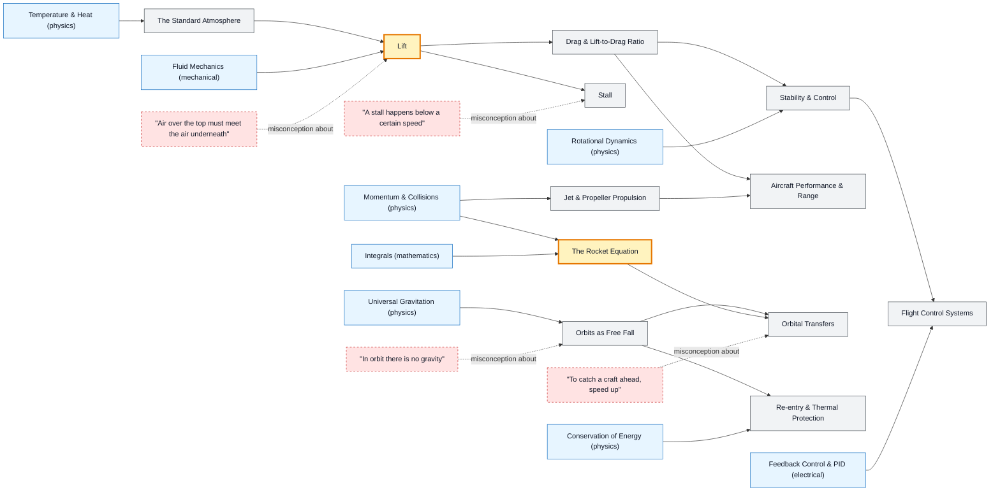

# Aerospace Engineering map

_Generated by `python scripts/dulta.py render` from `maps/aerospace.json`. Edit the JSON, not this file._

Flight in air and in orbit. Lift is the first threshold (a wing turns airflow downward; the popular 'equal transit' story is false); the rocket equation is the second (every kilometre per second of Δv costs exponentially more propellant), and orbits run on intuitions that are often backwards.

Solid arrows: prerequisite (A grounds B). Dotted arrows: a misconception that blocks the concept it points at. Thick amber nodes are threshold concepts (Meyer & Land): transformative, troublesome, irreversible.

| Node | Kind | Outcome | Retrieval check |
|---|---|---|---|
| `atmosphere` The Standard Atmosphere | concept | Read density at altitude from the standard atmosphere. | Roughly how does air density at 11 km compare with sea level? |
| `lift` Lift | threshold | Compute lift and explain it with both pressure and momentum. | If an aircraft doubles its airspeed at the same angle of attack, how does lift change? |
| `misc-transit` "Air over the top must meet the air underneath" | misconception | Refute equal transit time with flow observations. | Do air parcels split at a wing's leading edge meet again at the trailing edge? |
| `drag` Drag & Lift-to-Drag Ratio | concept | Find the speed for best glide from a drag polar. | A glider has L/D = 30. How far can it glide from 1 km up in still air? |
| `stall` Stall | concept | Explain stall and recover from it. | What causes a wing to stall? |
| `misc-stallspeed` "A stall happens below a certain speed" | misconception | Explain an accelerated stall. | Can a wing stall at high speed? |
| `stability` Stability & Control | concept | Check static stability from CG and neutral-point positions. | Why must an aircraft's centre of gravity be ahead of its neutral point? |
| `performance` Aircraft Performance & Range | concept | Estimate range with the Breguet equation. | By the Breguet range equation, what increases an aircraft's range? |
| `propulsion` Jet & Propeller Propulsion | concept | Compare turbojet, turbofan and propeller efficiency. | Why are high-bypass turbofans more fuel-efficient than turbojets? |
| `rocket` The Rocket Equation | threshold | Compute Δv and explain why staging helps. | A rocket with exhaust velocity 3 km/s and a mass ratio of e (≈2.72) can gain how much Δv? |
| `orbits` Orbits as Free Fall | concept | Compute circular orbital speed and period. | What speed keeps a satellite in a circular orbit 400 km up (r ≈ 6,771 km)? |
| `misc-nograv` "In orbit there is no gravity" | misconception | Explain weightlessness as free fall. | Gravity at the ISS's altitude is roughly what percentage of surface gravity? |
| `hohmann` Orbital Transfers | concept | Compute Δv for a Hohmann transfer. | To move to a higher circular orbit with a Hohmann transfer, how many engine burns are needed? |
| `misc-catchup` "To catch a craft ahead, speed up" | misconception | Plan a phasing manoeuvre to catch up with a target. | You are behind another spacecraft in the same orbit. Why doesn't a prograde burn help you catch it? |
| `reentry` Re-entry & Thermal Protection | concept | Explain why blunt shapes survive re-entry. | Why do capsules re-enter blunt end first? |
| `flightcontrol` Flight Control Systems | concept | Explain how fly-by-wire enables relaxed stability. | Why do fly-by-wire fighters use deliberately unstable airframes? |

Sources: Anderson: Introduction to Flight; Anderson: Fundamentals of Aerodynamics; Curtis: Orbital Mechanics for Engineering Students; Sutton & Biblarz: Rocket Propulsion Elements; Raymer: Aircraft Design: A Conceptual Approach
