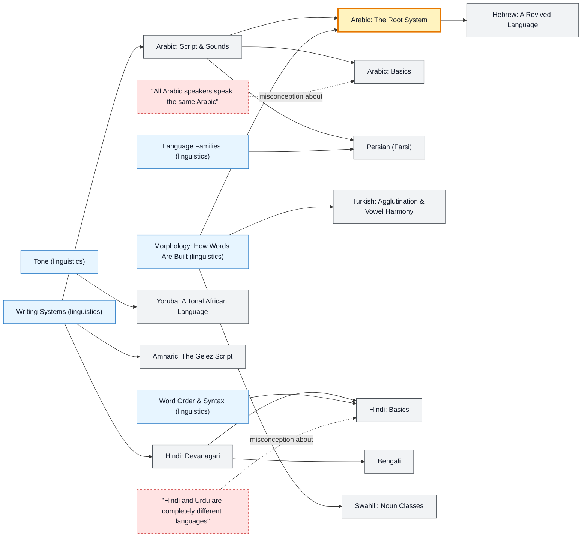

# Middle Eastern, South Asian & African Languages map

_Generated by `python scripts/dulta.py render` from `maps/afroasian.json`. Edit the JSON, not this file._

Arabic, Hebrew, Persian, Turkish, Hindi, Bengali, Swahili, Yoruba and Amharic. Root-and-pattern morphology (Arabic, Hebrew) and agglutination (Turkish, Swahili) are the thresholds: words become formulas you can build, not lists you memorise.

Solid arrows: prerequisite (A grounds B). Dotted arrows: a misconception that blocks the concept it points at. Thick amber nodes are threshold concepts (Meyer & Land): transformative, troublesome, irreversible.

| Node | Kind | Outcome | Retrieval check |
|---|---|---|---|
| `ar-script` Arabic: Script & Sounds | concept | Read Arabic letters in their joined forms. | In which direction is Arabic written? |
| `ar-roots` Arabic: The Root System | threshold | Derive related words from one root. | Arabic words built on the root k-t-b (كتب) share what meaning? |
| `ar-basics` Arabic: Basics | concept | Greet and thank in Arabic. | How do you say 'thank you' in Arabic? |
| `misc-ar-dialects` "All Arabic speakers speak the same Arabic" | misconception | Explain diglossia in Arabic. | Why might a Moroccan and an Iraqi struggle with each other's everyday Arabic? |
| `he` Hebrew: A Revived Language | concept | Read Hebrew letters and recognise shared Semitic roots. | In roughly which period was Hebrew revived as an everyday spoken language? |
| `fa` Persian (Farsi) | concept | Explain why Persian looks like Arabic but is related to English. | Which language family does Persian belong to? |
| `tr` Turkish: Agglutination & Vowel Harmony | concept | Build and parse Turkish words suffix by suffix. | Turkish stacks suffixes: 'ev' (house) becomes 'evlerim'. What does 'evlerim' mean? |
| `hi-script` Hindi: Devanagari | concept | Read Devanagari syllables. | What is the horizontal line along the top of Devanagari letters called? |
| `hi-basics` Hindi: Basics | concept | Greet respectfully and form simple Hindi sentences. | How do you greet someone respectfully in Hindi? |
| `misc-hindi-urdu` "Hindi and Urdu are completely different languages" | misconception | Explain how Hindi and Urdu differ and overlap. | Why can Hindi and Urdu speakers usually understand each other in conversation? |
| `bn` Bengali | concept | Locate Bengali-speaking regions and read its script basics. | In which two countries is Bengali official, nationally or in a state? |
| `sw` Swahili: Noun Classes | concept | Use Swahili noun-class prefixes and greet. | How do you say 'thank you' in Swahili? |
| `yo` Yoruba: A Tonal African Language | concept | Read Yoruba tone marks. | How many basic tones does Yoruba have? |
| `am` Amharic: The Ge'ez Script | concept | Explain how the Ge'ez script encodes vowels. | What kind of writing system is the Ge'ez script used for Amharic? |

Sources: Ryding: A Reference Grammar of Modern Standard Arabic; Göksel & Kerslake: Turkish: A Comprehensive Grammar; Kachru: Hindi; Mohammed: Modern Swahili Grammar; Daniels & Bright: The World's Writing Systems
