# Teaching Agents map

_Generated by `python scripts/dulta.py render` from `maps/agents.json`. Edit the JSON, not this file._

How to teach an AI agent a domain, and prove it learned. An agent's weights do not change in a session; it learns only through what enters its context and what is written down for the next one. The threshold is the cold-start test: knowledge counts only if a fresh agent, given the notes and not the answers, passes held-out checks.

Solid arrows: prerequisite (A grounds B). Dotted arrows: a misconception that blocks the concept it points at. Thick amber nodes are threshold concepts (Meyer & Land): transformative, troublesome, irreversible.

```mermaid
flowchart LR
  agents__context["Context Is the Classroom"]:::concept
  agents__misc_remember["#quot;The agent will remember next time#quot;"]:::misconception
  agents__outcomes["Outcomes as Specs"]:::concept
  agents__anchors["Semantic Anchors"]:::concept
  agents__examples["Worked Examples & Few-Shot"]:::concept
  agents__skills["Skill Files: Distilled Procedures"]:::concept
  agents__misc_more["#quot;More context always helps#quot;"]:::misconception
  agents__evals["Evals: Held-Out Checks"]:::threshold
  agents__coldstart["The Cold-Start Test"]:::threshold
  agents__contamination["Answer-Key Hygiene"]:::concept
  agents__misc_selfgrade["#quot;An agent can grade its own answers#quot;"]:::misconception
  agents__panels["Independent Critic Panels"]:::concept
  agents__tools["Tools as Procedural Knowledge"]:::concept
  agents__memory["Durable Memory & Carry-Forward"]:::concept
  agents__drift["Bounded Loops & Drift"]:::concept
  agents__agenttransfer["Agent Transfer"]:::concept
  developer__agents["Working with Coding Agents (developer)"]:::external
  learning__goals["Outcomes Before Content (learning)"]:::external
  learning__retrieval["Retrieval Practice (learning)"]:::external
  learning__transfer["Far Transfer (learning)"]:::external
  learning__worked["Worked Examples & Fading (learning)"]:::external
  agents__context --> agents__outcomes
  agents__misc_remember -.->|misconception about| agents__context
  learning__goals --> agents__outcomes
  agents__context --> agents__anchors
  agents__context --> agents__examples
  learning__worked --> agents__examples
  agents__misc_more -.->|misconception about| agents__examples
  agents__outcomes --> agents__evals
  agents__examples --> agents__evals
  agents__evals --> agents__contamination
  agents__misc_selfgrade -.->|misconception about| agents__contamination
  agents__anchors --> agents__skills
  agents__examples --> agents__skills
  agents__skills --> agents__coldstart
  agents__evals --> agents__coldstart
  learning__retrieval --> agents__coldstart
  agents__contamination --> agents__panels
  developer__agents --> agents__tools
  agents__skills --> agents__tools
  agents__coldstart --> agents__memory
  agents__panels --> agents__drift
  agents__memory --> agents__drift
  agents__coldstart --> agents__agenttransfer
  learning__transfer --> agents__agenttransfer
  classDef concept fill:#f1f3f5,stroke:#495057,color:#111827
  classDef threshold fill:#fff3bf,stroke:#e67700,stroke-width:3px,color:#111827
  classDef misconception fill:#ffe3e3,stroke:#c92a2a,stroke-dasharray:4,color:#111827
  classDef external fill:#e7f5ff,stroke:#1971c2,color:#111827
  classDef mastered fill:#d3f9d8,stroke:#2b8a3e,color:#111827
  classDef frontier fill:#ffffff,stroke:#111827,stroke-width:3px,color:#111827
```

| Node | Kind | Outcome | Retrieval check |
|---|---|---|---|
| `context` Context Is the Classroom | concept | List exactly what an agent can know at a given step. | You correct an agent's mistake mid-session. What has changed in the model? |
| `misc-remember` "The agent will remember next time" | misconception | Persist a correction so a new session obeys it. | An agent apologises and promises not to repeat a mistake. What makes that promise true? |
| `outcomes` Outcomes as Specs | concept | Rewrite a vague instruction as outcomes with checks. | Rewrite 'be good at our codebase' as a testable outcome. |
| `anchors` Semantic Anchors | concept | Compress a procedure by replacing explanations with anchors, then verify behaviour is unchanged. | Why can 'use the Socratic Method' replace a paragraph of instructions? |
| `examples` Worked Examples & Few-Shot | concept | Design a few-shot set that covers edge cases without being copied verbatim. | All three of your examples are short. What is the risk? |
| `skills` Skill Files: Distilled Procedures | concept | Distil a successful session into a skill with a contract, workflow and checks. | What separates a good skill from a long prompt? |
| `misc-more` "More context always helps" | misconception | Trim a context and measure whether accuracy improves. | Where in a long context is a key fact least reliably used? |
| `evals` Evals: Held-Out Checks | threshold | Build a held-out eval set and report accuracy before and after teaching. | Why must eval questions never appear in the teaching material? |
| `coldstart` The Cold-Start Test | threshold | Run a cold-start test and revise the notes from its failures. | A tutor agent answers every check perfectly. Why is that not evidence the skill file works? |
| `contamination` Answer-Key Hygiene | concept | Generate quiz prompts without answers and grade in a separate context. | How does `dulta.py quiz` support answer-key hygiene? |
| `misc-selfgrade` "An agent can grade its own answers" | misconception | Set up an independent grader and control for position bias. | Name two biases of LLM-as-judge. |
| `panels` Independent Critic Panels | concept | Convene a panel with seats that disagree, each citing evidence. | Why should panel seats not see each other's verdicts in the same round? |
| `tools` Tools as Procedural Knowledge | concept | Write tool guidance with a when-to-use rule and a verification step. | An agent has a calculator tool but still does arithmetic in its head. What is missing from its teaching? |
| `memory` Durable Memory & Carry-Forward | concept | Write a carry-forward entry with its evidence and verify it is loaded next session. | What should a carry-forward entry contain besides the fact? |
| `drift` Bounded Loops & Drift | concept | Add caps and a goal re-check to an iterative agent workflow. | A critic loop keeps raising the same objection. What should a bounded workflow do? |
| `agenttransfer` Agent Transfer | concept | Design a transfer task and score an agent's attempt. | Why is an agent passing tasks that resemble its few-shot examples weak evidence? |

Sources: Brown et al.: Language Models are Few-Shot Learners (2020); Liu et al.: Lost in the Middle: How Language Models Use Long Contexts (2023); Zheng et al.: Judging LLM-as-a-Judge with MT-Bench and Chatbot Arena (2023); Semantic Anchors catalog (llm-coding.github.io/Semantic-Anchors); Anthropic: Agent Skills documentation
