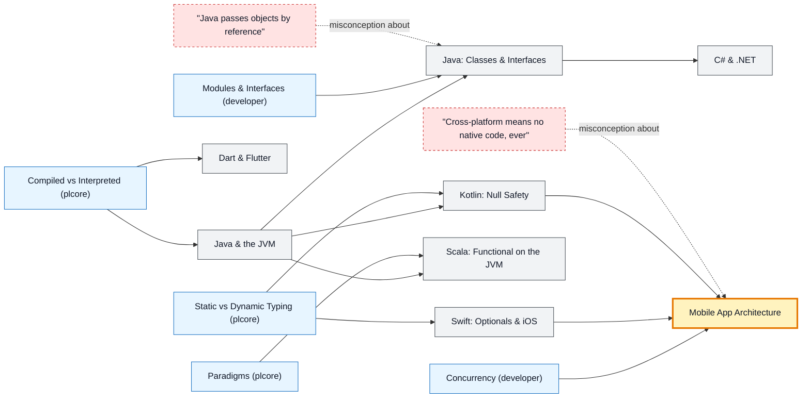

# Application & Mobile Languages map

_Generated by `python scripts/dulta.py render` from `maps/applang.json`. Edit the JSON, not this file._

Java, Kotlin, C#, Swift, Dart and Scala: the languages of enterprise back ends and phone apps. Null safety is the thread running through the modern ones; the UI thread is the threshold of mobile work.

Solid arrows: prerequisite (A grounds B). Dotted arrows: a misconception that blocks the concept it points at. Thick amber nodes are threshold concepts (Meyer & Land): transformative, troublesome, irreversible.

| Node | Kind | Outcome | Retrieval check |
|---|---|---|---|
| `java` Java & the JVM | concept | Build and run a Java program and explain the JVM's role. | What does 'write once, run anywhere' rely on in Java? |
| `java-oop` Java: Classes & Interfaces | concept | Design a class hierarchy using interfaces. | What is the difference between an interface and an abstract class in Java? |
| `misc-javaref` "Java passes objects by reference" | misconception | Predict whether a method can replace a caller's object. | Does Java pass object arguments by reference? |
| `kotlin` Kotlin: Null Safety | concept | Use safe calls and the Elvis operator. | In Kotlin, can a variable of type String (without a question mark) hold null? |
| `csharp` C# & .NET | concept | Query a collection with LINQ. | What does LINQ let you do in C#? |
| `swift` Swift: Optionals & iOS | concept | Unwrap optionals safely in Swift. | What does Swift's 'if let' do with an optional? |
| `dart` Dart & Flutter | concept | Build a Flutter screen and use hot reload. | What does Flutter's hot reload do? |
| `scala` Scala: Functional on the JVM | concept | Write a data pipeline with Scala collections. | Which big-data engine is written in Scala? |
| `mobile` Mobile App Architecture | threshold | Move slow work off the UI thread and survive app lifecycle changes. | Why must long network calls stay off a mobile app's main (UI) thread? |
| `misc-crossplatform` "Cross-platform means no native code, ever" | misconception | Plan where native code is needed in a cross-platform app. | Does a Flutter or React Native app ever need native Swift or Kotlin code? |

Sources: Bloch: Effective Java; Jemerov & Isakova: Kotlin in Action; Skeet: C# in Depth; Apple: The Swift Programming Language; Odersky, Spoon, Venners: Programming in Scala
