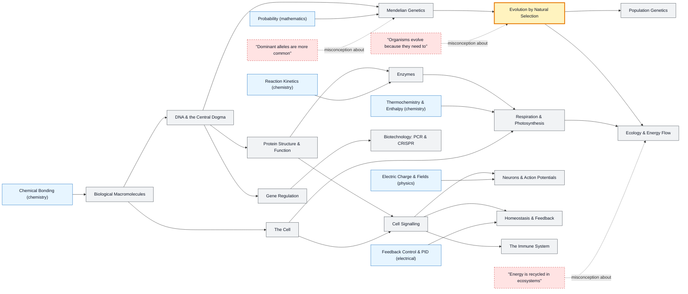

# Biology map

_Generated by `python scripts/dulta.py render` from `maps/biology.json`. Edit the JSON, not this file._

Life as chemistry that copies itself. Evolution by natural selection is the threshold that organises everything else; the central dogma and homeostasis are the two mechanisms every later topic leans on.

Solid arrows: prerequisite (A grounds B). Dotted arrows: a misconception that blocks the concept it points at. Thick amber nodes are threshold concepts (Meyer & Land): transformative, troublesome, irreversible.

| Node | Kind | Outcome | Retrieval check |
|---|---|---|---|
| `cell` The Cell | concept | Relate an organelle's structure to its function. | What do mitochondria and chloroplasts have that hints at their bacterial origin? |
| `macromolecules` Biological Macromolecules | concept | Identify monomers and bonds for each class. | What bond joins amino acids in a protein? |
| `dna` DNA & the Central Dogma | concept | Transcribe and translate a short sequence. | The DNA template strand reads 3′-TAC-5′. What is the mRNA codon, and which amino acid does it code for? |
| `proteins` Protein Structure & Function | concept | Explain how one amino-acid change can disable a protein. | How does a single amino-acid substitution cause sickle-cell disease? |
| `enzymes` Enzymes | concept | Interpret a Michaelis–Menten plot with and without an inhibitor. | Why does an enzyme's rate level off at high substrate concentration? |
| `metabolism` Respiration & Photosynthesis | concept | Trace where the ATP from one glucose comes from. | Which stage of aerobic respiration makes most of the ATP? |
| `genetics` Mendelian Genetics | concept | Predict a dihybrid cross ratio. | Two heterozygotes (Aa × Aa) mate. What fraction of offspring show the recessive trait? |
| `misc-dominant` "Dominant alleles are more common" | misconception | Separate dominance from allele frequency. | Will a dominant allele spread through a population because it is dominant? |
| `evolution` Evolution by Natural Selection | threshold | Explain antibiotic resistance with variation and selection. | How do bacterial populations become antibiotic-resistant? |
| `misc-need` "Organisms evolve because they need to" | misconception | Rewrite a teleological explanation in selection terms. | 'Giraffes grew long necks to reach high leaves.' What is wrong, and how should it be rephrased? |
| `popgen` Population Genetics | concept | Use Hardy–Weinberg to estimate carrier frequency. | A recessive disease affects 1 in 10,000. Roughly what fraction are carriers? |
| `regulation` Gene Regulation | concept | Explain the lac operon's response to lactose and glucose. | Every cell in your body has the same DNA. Why are neurons different from liver cells? |
| `signalling` Cell Signalling | concept | Trace a signal from receptor to response. | How can a few hormone molecules cause a large cellular response? |
| `neurons` Neurons & Action Potentials | concept | Explain the phases of an action potential with ion movements. | What causes the rising phase of an action potential? |
| `homeostasis` Homeostasis & Feedback | concept | Diagram a negative-feedback loop for blood glucose. | Blood glucose rises after a meal. What hormone responds and what does it do? |
| `immune` The Immune System | concept | Explain how a vaccine creates memory. | Why is the second exposure to a pathogen usually milder? |
| `ecology` Ecology & Energy Flow | concept | Compute energy available at a higher trophic level. | Roughly what fraction of energy passes from one trophic level to the next? |
| `misc-energycycle` "Energy is recycled in ecosystems" | misconception | Distinguish matter cycling from energy flow. | When a decomposer breaks down a dead tree, is the tree's energy returned to plants? |
| `biotech` Biotechnology: PCR & CRISPR | concept | Explain the steps of PCR and how Cas9 finds its target. | After 30 PCR cycles, roughly how many copies come from one template? |

Sources: Alberts et al.: Molecular Biology of the Cell; Campbell & Reece: Biology; Dobzhansky: Nothing in Biology Makes Sense Except in the Light of Evolution (1973); Bishop & Anderson: Student conceptions of natural selection (1990)
