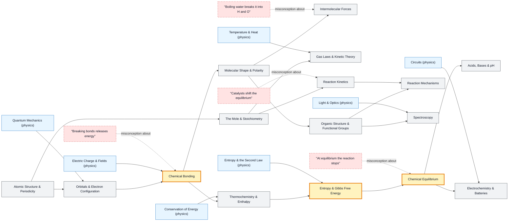

# Chemistry map

_Generated by `python scripts/dulta.py render` from `maps/chemistry.json`. Edit the JSON, not this file._

Matter by the electron. The bond as an energy well, dynamic equilibrium, and free energy are the thresholds; each overturns a common-sense idea (that breaking bonds releases energy, that equilibrium means nothing happens, that reactions go 'downhill' only in energy).

Solid arrows: prerequisite (A grounds B). Dotted arrows: a misconception that blocks the concept it points at. Thick amber nodes are threshold concepts (Meyer & Land): transformative, troublesome, irreversible.

| Node | Kind | Outcome | Retrieval check |
|---|---|---|---|
| `atoms` Atomic Structure & Periodicity | concept | Predict a periodic trend and explain it with effective nuclear charge. | Why does atomic radius decrease across a period? |
| `orbitals` Orbitals & Electron Configuration | concept | Write the electron configuration of a transition element. | What is the electron configuration of oxygen? |
| `moles` The Mole & Stoichiometry | concept | Find the limiting reagent and theoretical yield. | How many moles are in 36 g of water (M = 18 g/mol)? |
| `bonding` Chemical Bonding | threshold | Explain bond energy and predict ionic, covalent or metallic bonding. | Does breaking a chemical bond release or absorb energy? |
| `misc-atp` "Breaking bonds releases energy" | misconception | Explain where the energy of ATP hydrolysis comes from. | ATP hydrolysis releases energy. Is that because the broken phosphate bond releases energy? |
| `shape` Molecular Shape & Polarity | concept | Predict shape and polarity with VSEPR. | CO₂ has polar bonds. Is the molecule polar? |
| `imf` Intermolecular Forces | concept | Rank boiling points by intermolecular forces. | Why does water boil at 100 °C while H₂S, a heavier molecule, boils at −60 °C? |
| `misc-boil` "Boiling water breaks it into H and O" | misconception | Distinguish a physical from a chemical change at the particle level. | What is inside the bubbles in boiling water? |
| `gases` Gas Laws & Kinetic Theory | concept | Use the ideal gas law to find an unknown. | A sealed gas is heated from 300 K to 600 K at constant volume. Pressure? |
| `thermochem` Thermochemistry & Enthalpy | concept | Compute ΔH with Hess's law. | What does a negative ΔH mean? |
| `gibbs` Entropy & Gibbs Free Energy | threshold | Predict spontaneity from ΔH, ΔS and T. | Ice melts spontaneously at 25 °C although melting is endothermic. Why? |
| `equilibrium` Chemical Equilibrium | threshold | Compute concentrations at equilibrium from K and predict shifts. | Adding more reactant to a system at equilibrium does what? |
| `misc-stop` "At equilibrium the reaction stops" | misconception | Describe equilibrium at the particle level. | Radioactive iodine is added to a saturated solution in equilibrium with solid iodine. Where does it end up? |
| `kinetics` Reaction Kinetics | concept | Determine a rate law from initial-rate data. | Why does a 10 °C rise often roughly double a reaction rate? |
| `misc-catalyst` "Catalysts shift the equilibrium" | misconception | Separate kinetic from thermodynamic effects. | Does adding a catalyst increase the equilibrium yield? |
| `acidbase` Acids, Bases & pH | concept | Calculate the pH of a buffer with Henderson–Hasselbalch. | What is the pH of 0.01 M HCl? |
| `electrochem` Electrochemistry & Batteries | concept | Compute a cell potential from standard reduction potentials. | In a galvanic cell, where does oxidation happen? |
| `organic` Organic Structure & Functional Groups | concept | Name a molecule and identify its functional groups. | Which functional group defines an alcohol? |
| `mechanisms` Reaction Mechanisms | concept | Draw an SN2 mechanism with correct arrows. | In a curly-arrow mechanism, what does the arrow represent? |
| `spectroscopy` Spectroscopy | concept | Identify a compound from IR and ¹H NMR data. | A strong IR band near 1700 cm⁻¹ suggests what group? |

Sources: Atkins & Jones: Chemical Principles; Clayden, Greeves, Warren: Organic Chemistry; Taber: Chemical Misconceptions (RSC, 2002); Boo: Students' understandings of chemical bonds and the energetics of reactions (1998)
