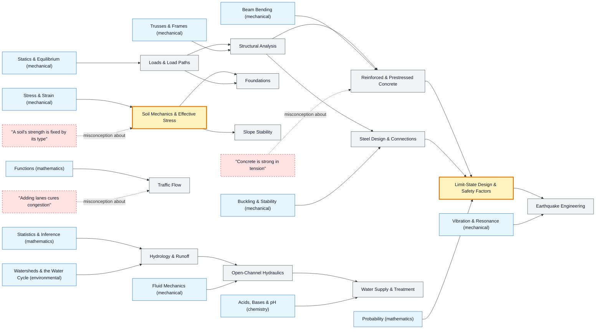

# Civil & Structural Engineering map

_Generated by `python scripts/dulta.py render` from `maps/civil.json`. Edit the JSON, not this file._

Structures, ground, water and roads. Two thresholds: effective stress (water pressure, not just load, decides whether soil holds) and limit-state design (a structure is safe when its probability of failure is acceptably small, not when the numbers are exact).

Solid arrows: prerequisite (A grounds B). Dotted arrows: a misconception that blocks the concept it points at. Thick amber nodes are threshold concepts (Meyer & Land): transformative, troublesome, irreversible.

| Node | Kind | Outcome | Retrieval check |
|---|---|---|---|
| `loads` Loads & Load Paths | concept | Trace the load path of a roof load to the foundations. | A snow load on a roof must ultimately go where? |
| `analysis` Structural Analysis | concept | Find member forces in a truss and say which are in tension. | What is the main advantage of a statically determinate structure? |
| `misc-concrete` "Concrete is strong in tension" | misconception | Place reinforcement where bending puts concrete in tension. | Where is steel reinforcement placed in a simply supported concrete beam, and why? |
| `concrete` Reinforced & Prestressed Concrete | concept | Size reinforcement for a beam and explain prestressing. | Why prestress a concrete beam? |
| `steel` Steel Design & Connections | concept | Check a steel column for yielding and buckling. | Why do engineers check both yielding and buckling for a steel column? |
| `limitstate` Limit-State Design & Safety Factors | threshold | Apply load and resistance factors to a design check. | Why multiply design loads by factors greater than 1? |
| `soil` Soil Mechanics & Effective Stress | threshold | Compute effective stress below the water table. | Why can a saturated slope fail after heavy rain with no extra load on it? |
| `misc-soil` "A soil's strength is fixed by its type" | misconception | Explain liquefaction with effective stress. | Is a soil's shear strength fixed by its type alone? |
| `foundations` Foundations | concept | Choose between a footing and piles for a site. | Why are pile foundations used under tall buildings on soft clay? |
| `slopes` Slope Stability | concept | Compute a factor of safety for an infinite slope. | What does a factor of safety of 1.0 mean for a slope? |
| `hydrology` Hydrology & Runoff | concept | Estimate a peak flow and explain how urbanisation changes it. | Paving over a field: what happens to peak runoff, and why? |
| `hydraulics` Open-Channel Hydraulics | concept | Size a channel with Manning's equation. | By Manning's equation, what happens to flow velocity if channel roughness n doubles, all else equal? |
| `water` Water Supply & Treatment | concept | Lay out a treatment train from river intake to tap. | Why is a chlorine residual maintained in drinking-water pipes? |
| `traffic` Traffic Flow | concept | Read a fundamental diagram and find capacity. | On a freeway, flow q = density k × speed v. At jam density, what is the flow? |
| `misc-lanes` "Adding lanes cures congestion" | misconception | Explain induced demand with an example. | Why do widened roads often fill up again within a few years? |
| `seismic` Earthquake Engineering | concept | Explain why building height changes earthquake response. | Why might a 10-storey building sway more in an earthquake than a 2-storey one beside it? |

Sources: Hibbeler: Structural Analysis; Craig: Soil Mechanics; Chow, Maidment, Mays: Applied Hydrology; Mays: Water Resources Engineering; Mannering & Washburn: Principles of Highway Engineering and Traffic Analysis
