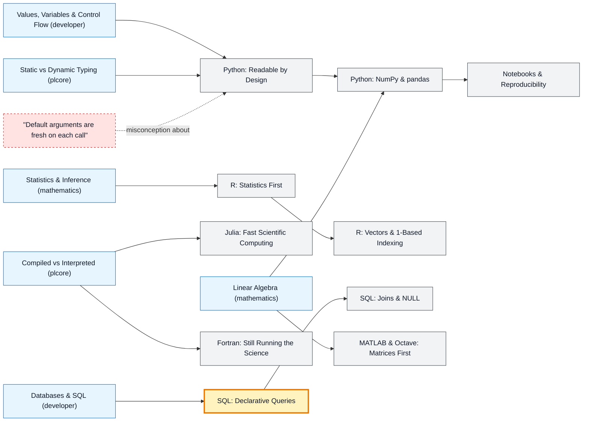

# Data & Scientific Languages map

_Generated by `python scripts/dulta.py render` from `maps/datalang.json`. Edit the JSON, not this file._

Python, R, Julia, SQL, MATLAB and Fortran: the languages of analysis, modelling and simulation. SQL's declarative style is the threshold: you describe the result, and the database decides how to get it.

Solid arrows: prerequisite (A grounds B). Dotted arrows: a misconception that blocks the concept it points at. Thick amber nodes are threshold concepts (Meyer & Land): transformative, troublesome, irreversible.

| Node | Kind | Outcome | Retrieval check |
|---|---|---|---|
| `py` Python: Readable by Design | concept | Write idiomatic Python with functions, comprehensions and modules. | What does indentation do in Python? |
| `misc-pydefault` "Default arguments are fresh on each call" | misconception | Use None as the default for mutable arguments. | def f(x=[]): x.append(1); return x. What does the second call to f() return? |
| `py-data` Python: NumPy & pandas | concept | Replace a Python loop with a vectorised NumPy expression. | Why is a vectorised NumPy operation much faster than a Python for-loop over the same numbers? |
| `notebooks` Notebooks & Reproducibility | concept | Turn a notebook into a reproducible script with pinned dependencies. | What is a common reproducibility trap in Jupyter notebooks? |
| `r` R: Statistics First | concept | Load, summarise and plot a data set in R. | What is R's basic data structure for a table of observations? |
| `r-index` R: Vectors & 1-Based Indexing | concept | Index and filter vectors in R. | In R, what is x[1] for x <- c(10, 20, 30)? |
| `julia` Julia: Fast Scientific Computing | concept | Write a type-stable Julia function and benchmark it. | How does Julia reach C-like speed while being dynamic? |
| `sql` SQL: Declarative Queries | threshold | Express a multi-table question as one SQL query. | In SQL, do you tell the database how to find the rows, or what rows you want? |
| `sql-null` SQL: Joins & NULL | concept | Write joins that keep or drop unmatched rows deliberately. | Does WHERE x = NULL find rows where x is NULL? |
| `matlab` MATLAB & Octave: Matrices First | concept | Vectorise a calculation in MATLAB. | In MATLAB, what is the difference between A*B and A.*B? |
| `fortran` Fortran: Still Running the Science | concept | Read a Fortran array loop and call it from Python. | Why is Fortran still used in climate and physics codes? |

Sources: Lutz: Learning Python; McKinney: Python for Data Analysis; Wickham & Grolemund: R for Data Science; Bezanson et al.: Julia: A Fresh Approach to Numerical Computing (2017); Date: SQL and Relational Theory
