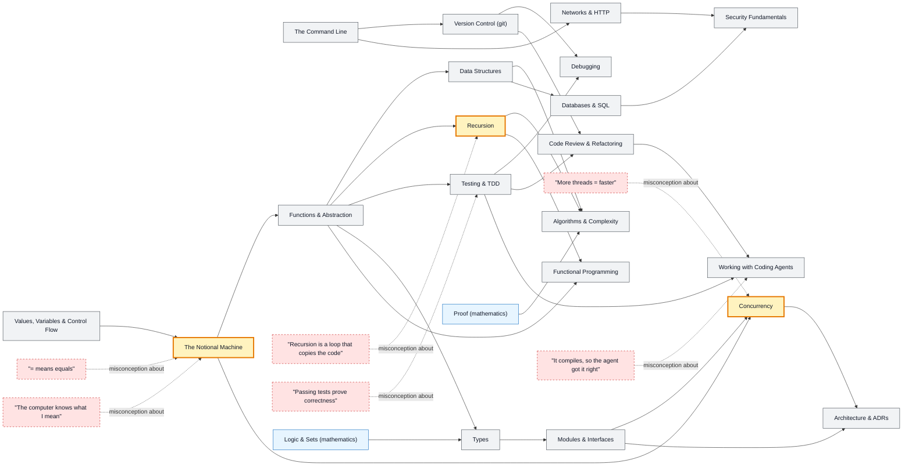

# Developer map

_Generated by `python scripts/dulta.py render` from `maps/developer.json`. Edit the JSON, not this file._

From the first program to working with coding agents. The notional machine is the first threshold: until a learner can trace what the computer actually does, every later topic is memorised syntax.

Solid arrows: prerequisite (A grounds B). Dotted arrows: a misconception that blocks the concept it points at. Thick amber nodes are threshold concepts (Meyer & Land): transformative, troublesome, irreversible.

| Node | Kind | Outcome | Retrieval check |
|---|---|---|---|
| `shell` The Command Line | concept | Chain three commands with pipes to answer a question about a file. | What does `grep -c error log.txt` print? |
| `basics` Values, Variables & Control Flow | concept | Write a loop that accumulates a result. | After `x = 1; for i in 1..3: x = x * 2`, what is x? |
| `misc-assign` "= means equals" | misconception | Trace a sequence of assignments in a memory table. | `a = 1; b = a; a = 2`. What is b? |
| `notional` The Notional Machine | threshold | Draw stack and heap for a short program with a function call and a list. | `xs = [1]; ys = xs; ys.append(2)`. What is xs? |
| `misc-intent` "The computer knows what I mean" | misconception | Find the gap between a stated intent and the code's literal behaviour. | A loop meant to run 10 times is written `for i in range(1, 10)`. How many times does it run? |
| `functions` Functions & Abstraction | concept | Refactor duplicated code into a function with a clear contract. | What is the difference between a parameter and an argument? |
| `git` Version Control (git) | concept | Branch, commit, and merge a change; recover a lost commit with reflog. | What does a git branch actually store? |
| `datastructs` Data Structures | concept | Choose a data structure for a workload and justify its costs. | Why is looking up a key in a hash map usually O(1)? |
| `recursion` Recursion | threshold | Write a recursive tree traversal with a correct base case. | What two parts does every terminating recursive function need? |
| `misc-recursion` "Recursion is a loop that copies the code" | misconception | Trace fact(3) showing each stack frame. | In fact(3), how many frames are on the stack at the deepest point (with base case n = 0)? |
| `complexity` Algorithms & Complexity | concept | Determine the big-O of a nested loop and compare two algorithms. | Binary search on 1,000,000 sorted items takes at most about how many comparisons? |
| `testing` Testing & TDD | concept | Write a failing test first, then the code that passes it. | In TDD, why must the new test fail before you write the code? |
| `misc-tests` "Passing tests prove correctness" | misconception | Write code that passes a weak test suite yet is wrong. | All 5 tests pass. What can you conclude? |
| `debugging` Debugging | concept | Bisect a failure to the smallest reproducing case. | What does `git bisect` search for? |
| `types` Types | concept | Model a domain so illegal states are unrepresentable. | What does a type checker guarantee about a well-typed program? |
| `modules` Modules & Interfaces | concept | Split a program into modules by the decisions each hides. | By Parnas's criterion, what should a module hide? |
| `functional` Functional Programming | concept | Rewrite a loop with map, filter and reduce. | What makes a function pure? |
| `concurrency` Concurrency | threshold | Identify and fix a race condition. | Two threads each run `count += 1` 1000 times. Why can count end below 2000? |
| `misc-threads` "More threads = faster" | misconception | Apply Amdahl's law to a partly serial program. | If 50% of a program is serial, what is the best speed-up with infinite cores? |
| `http` Networks & HTTP | concept | Read an HTTP exchange and explain each part. | What does status 404 mean, and 500? |
| `databases` Databases & SQL | concept | Write a join and explain its result set. | What does a transaction's atomicity guarantee? |
| `security` Security Fundamentals | concept | Find and fix an injection vulnerability. | How do parameterized queries prevent SQL injection? |
| `architecture` Architecture & ADRs | concept | Write an ADR with options, decision and consequences. | What does an ADR record that a commit message does not? |
| `review` Code Review & Refactoring | concept | Apply a named refactoring under test. | What must stay the same during a refactoring? |
| `agents` Working with Coding Agents | concept | Write a spec and acceptance test, delegate it, and verify the result independently. | An agent says 'all tests pass'. What do you do before merging? |
| `misc-agent` "It compiles, so the agent got it right" | misconception | Construct an acceptance test that catches a plausible but wrong agent answer. | Why can a confident explanation from an agent still be wrong? |

Sources: Abelson & Sussman: Structure and Interpretation of Computer Programs; du Boulay: Some difficulties of learning to program (1986); Sorva: Notional machines and introductory programming education (2013); Hunt & Thomas: The Pragmatic Programmer; Beck: Test-Driven Development by Example
