# DevOps & SRE map

_Generated by `python scripts/dulta.py render` from `maps/devops.json`. Edit the JSON, not this file._

Shipping software and keeping it running. Two thresholds change how the work is seen: infrastructure as code (servers are text you review and version), and the error budget (reliability is a target you spend, not a perfection you chase).

Solid arrows: prerequisite (A grounds B). Dotted arrows: a misconception that blocks the concept it points at. Thick amber nodes are threshold concepts (Meyer & Land): transformative, troublesome, irreversible.

```mermaid
flowchart LR
  devops__linux["Linux & Processes"]:::concept
  devops__networking["Networking for Operators"]:::concept
  devops__containers["Containers & Images"]:::concept
  devops__misc_vm["#quot;A container is a lightweight VM#quot;"]:::misconception
  devops__ci["Continuous Integration"]:::concept
  devops__cd["Continuous Delivery & Deployment"]:::concept
  devops__iac["Infrastructure as Code"]:::threshold
  devops__misc_pets["#quot;Servers should be fixed by hand when they break#quot;"]:::misconception
  devops__config["Configuration & Secrets"]:::concept
  devops__orchestration["Orchestration (Kubernetes)"]:::concept
  devops__observability["Observability: Metrics, Logs, Traces"]:::concept
  devops__misc_average["#quot;Average latency tells you how users feel#quot;"]:::misconception
  devops__slo["SLOs & Error Budgets"]:::threshold
  devops__misc_100["#quot;The target should be 100% uptime#quot;"]:::misconception
  devops__incidents["Incident Response & Postmortems"]:::concept
  devops__supplychain["Supply Chain & DevSecOps"]:::concept
  devops__dora["Delivery Metrics (DORA)"]:::concept
  developer__git["Version Control (git) (developer)"]:::external
  developer__http["Networks & HTTP (developer)"]:::external
  developer__security["Security Fundamentals (developer)"]:::external
  developer__shell["The Command Line (developer)"]:::external
  developer__testing["Testing & TDD (developer)"]:::external
  mathematics__statistics["Statistics & Inference (mathematics)"]:::external
  developer__shell --> devops__linux
  developer__http --> devops__networking
  devops__linux --> devops__networking
  devops__linux --> devops__containers
  devops__misc_vm -.->|misconception about| devops__containers
  developer__git --> devops__ci
  developer__testing --> devops__ci
  devops__ci --> devops__cd
  devops__containers --> devops__cd
  devops__networking --> devops__iac
  devops__cd --> devops__iac
  devops__misc_pets -.->|misconception about| devops__iac
  developer__security --> devops__config
  devops__iac --> devops__config
  devops__containers --> devops__orchestration
  devops__iac --> devops__orchestration
  devops__orchestration --> devops__observability
  mathematics__statistics --> devops__observability
  devops__misc_average -.->|misconception about| devops__observability
  devops__observability --> devops__slo
  devops__misc_100 -.->|misconception about| devops__slo
  devops__slo --> devops__incidents
  devops__observability --> devops__incidents
  devops__config --> devops__supplychain
  devops__ci --> devops__supplychain
  devops__cd --> devops__dora
  devops__incidents --> devops__dora
  classDef concept fill:#f1f3f5,stroke:#495057,color:#111827
  classDef threshold fill:#fff3bf,stroke:#e67700,stroke-width:3px,color:#111827
  classDef misconception fill:#ffe3e3,stroke:#c92a2a,stroke-dasharray:4,color:#111827
  classDef external fill:#e7f5ff,stroke:#1971c2,color:#111827
  classDef mastered fill:#d3f9d8,stroke:#2b8a3e,color:#111827
  classDef frontier fill:#ffffff,stroke:#111827,stroke-width:3px,color:#111827
```

| Node | Kind | Outcome | Retrieval check |
|---|---|---|---|
| `linux` Linux & Processes | concept | Find and stop a runaway process and read its service logs. | A service won't start. Which two commands show its status and recent logs under systemd? |
| `networking` Networking for Operators | concept | Trace a failing request from DNS to the service port. | `curl https://api.example.com` fails but `curl https://10.0.0.5` works. What is the likely fault? |
| `containers` Containers & Images | concept | Write a Dockerfile and explain each layer's cache behaviour. | Why copy dependency manifests and install them before copying the source code in a Dockerfile? |
| `misc-vm` "A container is a lightweight VM" | misconception | Explain what a container shares with its host. | Can a Linux container run a Windows kernel driver on a Linux host? |
| `ci` Continuous Integration | concept | Write a CI pipeline that builds, tests and fails fast. | What does 'integrate continuously' actually require of developers? |
| `cd` Continuous Delivery & Deployment | concept | Choose a deployment strategy for a risky change and plan its rollback. | What does a canary release do? |
| `iac` Infrastructure as Code | threshold | Declare an environment in code and reproduce it from scratch. | Someone hot-fixes a server by hand. Why is that a problem under infrastructure as code? |
| `misc-pets` "Servers should be fixed by hand when they break" | misconception | Replace, rather than repair, a broken instance from its definition. | A server's disk is corrupted. Under 'cattle, not pets', what do you do? |
| `config` Configuration & Secrets | concept | Move a hard-coded secret to a secret store and rotate it. | An API key was committed to git and then deleted in the next commit. Is it safe? |
| `orchestration` Orchestration (Kubernetes) | concept | Deploy a service with readiness and liveness probes. | What is the difference between a readiness probe and a liveness probe? |
| `observability` Observability: Metrics, Logs, Traces | concept | Instrument a service with RED metrics and find a slow dependency with a trace. | What do the RED metrics stand for? |
| `misc-average` "Average latency tells you how users feel" | misconception | Read latency percentiles and explain tail amplification. | Mean latency is 50 ms but p99 is 2 s. What does that mean for users? |
| `slo` SLOs & Error Budgets | threshold | Set an SLO, compute its error budget and use it to decide on a release freeze. | A 99.9% monthly availability SLO allows how much downtime in a 30-day month? |
| `misc-100` "The target should be 100% uptime" | misconception | Argue for an SLO below 100% with the cost of each extra nine. | Why do SRE teams avoid a 100% availability target? |
| `incidents` Incident Response & Postmortems | concept | Run an incident: mitigate, communicate, then write a blameless postmortem with actions. | During an outage, what comes first: finding the root cause or mitigating? |
| `supplychain` Supply Chain & DevSecOps | concept | Add dependency scanning and artifact signing to a pipeline. | Why should a CI pipeline's credentials have the least privilege possible? |
| `dora` Delivery Metrics (DORA) | concept | Measure the four DORA metrics for a team and pick one to improve. | Accelerate found that speed and stability trade off against each other. True or false? |

Sources: Kim, Humble, Debois, Willis: The DevOps Handbook; Beyer, Jones, Petoff, Murphy: Site Reliability Engineering (Google); Forsgren, Humble, Kim: Accelerate; Humble & Farley: Continuous Delivery; Wiggins: The Twelve-Factor App
