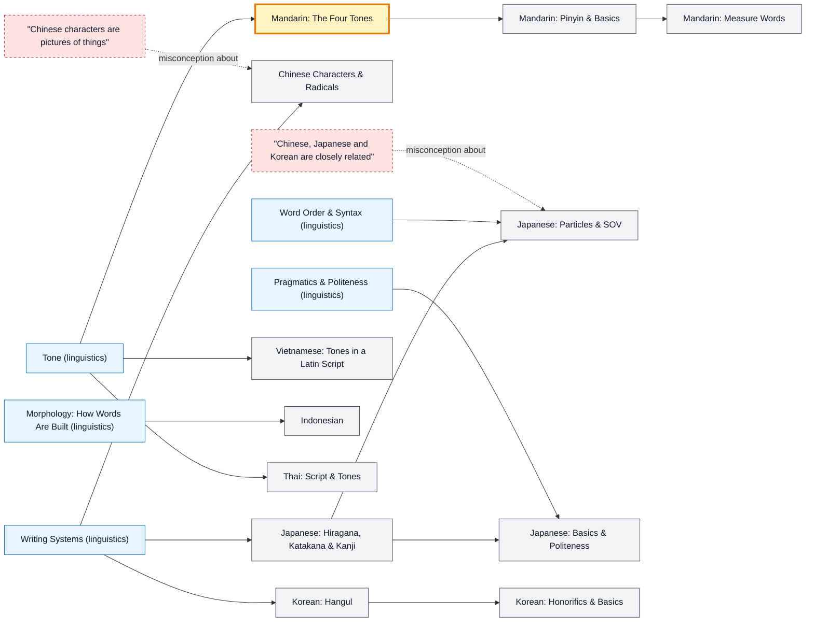

# East & Southeast Asian Languages map

_Generated by `python scripts/dulta.py render` from `maps/eastasian.json`. Edit the JSON, not this file._

Mandarin, Japanese, Korean, Vietnamese, Indonesian and Thai: three unrelated families that shared a writing culture, plus tonal and non-tonal neighbours. Tone and script are the two thresholds for most English speakers.

Solid arrows: prerequisite (A grounds B). Dotted arrows: a misconception that blocks the concept it points at. Thick amber nodes are threshold concepts (Meyer & Land): transformative, troublesome, irreversible.

| Node | Kind | Outcome | Retrieval check |
|---|---|---|---|
| `zh-tones` Mandarin: The Four Tones | threshold | Hear and produce the four tones on minimal sets. | How many lexical tones does Standard Mandarin have, not counting the neutral tone? |
| `zh-basics` Mandarin: Pinyin & Basics | concept | Greet and introduce yourself in Mandarin. | How do you say 'hello' in Mandarin? |
| `zh-chars` Chinese Characters & Radicals | concept | Use radicals to guess meaning and look characters up. | What does the radical in a Chinese character usually tell you? |
| `misc-pictograms` "Chinese characters are pictures of things" | misconception | Split a phono-semantic character into its parts. | Are most Chinese characters pictograms? |
| `zh-measure` Mandarin: Measure Words | concept | Use common measure words. | Which measure word is most general in Mandarin, as in 一__人 (one person)? |
| `ja-kana` Japanese: Hiragana, Katakana & Kanji | concept | Read both kana syllabaries and identify each script in a sentence. | Which Japanese script is mainly used for foreign loanwords? |
| `ja-particles` Japanese: Particles & SOV | concept | Build sentences with は, が, を, に and で. | Which particle marks the direct object in Japanese? |
| `ja-basics` Japanese: Basics & Politeness | concept | Greet and thank politely in Japanese. | How do you say 'thank you' politely in Japanese? |
| `misc-cjk` "Chinese, Japanese and Korean are closely related" | misconception | Explain borrowing versus genetic relationship. | Are Japanese and Korean related to Chinese the way Spanish is related to Italian? |
| `ko-hangul` Korean: Hangul | concept | Read Hangul syllable blocks aloud. | Who created Hangul, and roughly when? |
| `ko-basics` Korean: Honorifics & Basics | concept | Choose a speech level and thank someone politely. | How do you say 'thank you' politely in Korean? |
| `vi` Vietnamese: Tones in a Latin Script | concept | Read tone marks and greet in Vietnamese. | How many tones does Northern (Hanoi) Vietnamese have? |
| `idn` Indonesian | concept | Form plurals and derived verbs in Indonesian. | How do you make 'anak' (child) plural in Indonesian? |
| `th` Thai: Script & Tones | concept | Read Thai tone markers and segment a sentence. | Does written Thai put spaces between words? |

Sources: Li & Thompson: Mandarin Chinese: A Functional Reference Grammar; Shibatani: The Languages of Japan; Sohn: The Korean Language; DeFrancis: The Chinese Language: Fact and Fantasy; Sneddon et al.: Indonesian: A Comprehensive Grammar
