# Electrical Engineering map

_Generated by `python scripts/dulta.py render` from `maps/electrical.json`. Edit the JSON, not this file._

From Ohm's law to feedback control. Three thresholds reorganise the subject: impedance (AC circuits as complex algebra), feedback (a system that measures its own output), and state (logic that remembers).

Solid arrows: prerequisite (A grounds B). Dotted arrows: a misconception that blocks the concept it points at. Thick amber nodes are threshold concepts (Meyer & Land): transformative, troublesome, irreversible.

```mermaid
flowchart LR
  electrical__ohm["Ohm's Law & Power"]:::concept
  electrical__misc_voltflow["#quot;Voltage flows through the circuit#quot;"]:::misconception
  electrical__kirchhoff["Kirchhoff's Laws & Nodal Analysis"]:::concept
  electrical__divider["Voltage Dividers & Loading"]:::concept
  electrical__thevenin["Thévenin & Norton Equivalents"]:::concept
  electrical__rc["RC & RL Transients"]:::concept
  electrical__phasors["AC, Phasors & Impedance"]:::threshold
  electrical__filters["Filters & Frequency Response"]:::concept
  electrical__diodes["Diodes & Rectification"]:::concept
  electrical__transistors["Transistors as Switches & Amplifiers"]:::concept
  electrical__opamps["Op-Amps & Negative Feedback"]:::threshold
  electrical__boolean["Boolean Logic & Gates"]:::concept
  electrical__sequential["Flip-Flops & Sequential Logic"]:::threshold
  electrical__misc_faster["#quot;Sampling a bit faster than the signal is enough#quot;"]:::misconception
  electrical__sampling["Sampling, ADC & DAC"]:::concept
  electrical__signals["Signals, Systems & Laplace"]:::concept
  electrical__control["Feedback Control & PID"]:::concept
  electrical__misc_ground["#quot;Ground is where current disappears#quot;"]:::misconception
  mathematics__complex["Complex Numbers (mathematics)"]:::external
  mathematics__diffeq["Differential Equations (mathematics)"]:::external
  mathematics__fourier["Fourier Analysis (mathematics)"]:::external
  mathematics__logic["Logic & Sets (mathematics)"]:::external
  physics__circuits["Circuits (physics)"]:::external
  physics__circuits --> electrical__ohm
  electrical__ohm --> electrical__kirchhoff
  electrical__misc_voltflow -.->|misconception about| electrical__kirchhoff
  electrical__misc_ground -.->|misconception about| electrical__kirchhoff
  electrical__kirchhoff --> electrical__divider
  electrical__divider --> electrical__thevenin
  electrical__kirchhoff --> electrical__rc
  mathematics__diffeq --> electrical__rc
  electrical__rc --> electrical__phasors
  mathematics__complex --> electrical__phasors
  electrical__phasors --> electrical__filters
  mathematics__fourier --> electrical__filters
  electrical__kirchhoff --> electrical__diodes
  electrical__diodes --> electrical__transistors
  electrical__thevenin --> electrical__opamps
  electrical__transistors --> electrical__opamps
  mathematics__logic --> electrical__boolean
  electrical__transistors --> electrical__boolean
  electrical__boolean --> electrical__sequential
  electrical__filters --> electrical__sampling
  electrical__misc_faster -.->|misconception about| electrical__sampling
  electrical__filters --> electrical__signals
  electrical__signals --> electrical__control
  electrical__opamps --> electrical__control
  classDef concept fill:#f1f3f5,stroke:#495057,color:#111827
  classDef threshold fill:#fff3bf,stroke:#e67700,stroke-width:3px,color:#111827
  classDef misconception fill:#ffe3e3,stroke:#c92a2a,stroke-dasharray:4,color:#111827
  classDef external fill:#e7f5ff,stroke:#1971c2,color:#111827
  classDef mastered fill:#d3f9d8,stroke:#2b8a3e,color:#111827
  classDef frontier fill:#ffffff,stroke:#111827,stroke-width:3px,color:#111827
```

| Node | Kind | Outcome | Retrieval check |
|---|---|---|---|
| `ohm` Ohm's Law & Power | concept | Size a resistor for a given current and check its power rating. | An LED needs 20 mA with 2 V across it from a 5 V supply. What series resistor, and what power does it dissipate? |
| `misc-voltflow` "Voltage flows through the circuit" | misconception | State what is 'across' and what is 'through' for each element. | Is it correct to say '5 volts flows through the resistor'? |
| `kirchhoff` Kirchhoff's Laws & Nodal Analysis | concept | Solve a two-node circuit with nodal analysis. | Three wires meet at a node: 2 A in, 0.5 A in, and one unknown. What is the unknown current, and which way? |
| `divider` Voltage Dividers & Loading | concept | Compute a divider output with and without a load. | Two 10 kΩ resistors divide 10 V. A 10 kΩ load is connected across the bottom one. What is the output? |
| `thevenin` Thévenin & Norton Equivalents | concept | Reduce a network to its Thévenin equivalent and predict the current into a load. | How do you measure a black box's Thévenin resistance with a meter? |
| `rc` RC & RL Transients | concept | Predict a capacitor's voltage at any time after a step. | A capacitor charges through a resistor with τ = 1 ms. What fraction of the final voltage has it reached at 1 ms, and when is it 'done'? |
| `phasors` AC, Phasors & Impedance | threshold | Compute the impedance of a series RC at a given frequency. | What happens to a capacitor's impedance as frequency rises? |
| `filters` Filters & Frequency Response | concept | Design a first-order low-pass filter for a cutoff frequency. | What is the cutoff frequency of an RC low-pass with R = 1 kΩ, C = 1 µF? |
| `diodes` Diodes & Rectification | concept | Analyse a half-wave rectifier with a smoothing capacitor. | Why is a diode placed across a relay coil driven by a transistor? |
| `transistors` Transistors as Switches & Amplifiers | concept | Use a MOSFET to switch a load from a microcontroller pin. | Why use a transistor rather than driving a 1 A motor straight from a microcontroller pin? |
| `opamps` Op-Amps & Negative Feedback | threshold | Design an inverting amplifier with a given gain. | An inverting amplifier has R_in = 1 kΩ and R_f = 10 kΩ. What is its gain? |
| `boolean` Boolean Logic & Gates | concept | Build a half-adder from gates. | Which two gates make a half-adder, and for which outputs? |
| `sequential` Flip-Flops & Sequential Logic | threshold | Design a 2-bit counter from D flip-flops. | What does a D flip-flop do on a rising clock edge? |
| `misc-faster` "Sampling a bit faster than the signal is enough" | misconception | Predict the alias frequency of an undersampled sine. | A 900 Hz tone is sampled at 1000 Hz. What frequency appears? |
| `sampling` Sampling, ADC & DAC | concept | Choose sample rate and resolution for a sensor. | A 10-bit ADC with a 3.3 V reference reads 512. What voltage is that? |
| `signals` Signals, Systems & Laplace | concept | Derive the transfer function of an RC circuit. | What property lets you predict an LTI system's response to any input from its impulse response? |
| `control` Feedback Control & PID | concept | Tune a PID loop and explain the effect of each term. | A P-only controller leaves a steady error. Which term removes it? |
| `misc-ground` "Ground is where current disappears" | misconception | Trace the complete return path of a current. | Current flows from a battery through a lamp to 'ground'. Where does it go next? |

Sources: Horowitz & Hill: The Art of Electronics; Agarwal & Lang: Foundations of Analog and Digital Electronic Circuits; Oppenheim & Willsky: Signals and Systems; Åström & Murray: Feedback Systems; Harris & Harris: Digital Design and Computer Architecture
