# Embedded Systems map

_Generated by `python scripts/dulta.py render` from `maps/embedded.json`. Edit the JSON, not this file._

Microcontrollers from the bit up. The first threshold is the memory-mapped register: hardware is controlled by writing bits to addresses. The second is the interrupt: the program is no longer the only thing deciding what runs next.

Solid arrows: prerequisite (A grounds B). Dotted arrows: a misconception that blocks the concept it points at. Thick amber nodes are threshold concepts (Meyer & Land): transformative, troublesome, irreversible.

```mermaid
flowchart LR
  embedded__binary["Binary, Hex & Bitwise Operations"]:::concept
  embedded__misc_bittest["#quot;x & (1 << n) gives 1 or 0#quot;"]:::misconception
  embedded__arch["Microcontroller Architecture"]:::concept
  embedded__registers["Memory-Mapped Registers"]:::threshold
  embedded__gpio["GPIO: Inputs, Outputs & Pull-ups"]:::concept
  embedded__misc_float["#quot;An unconnected input reads 0#quot;"]:::misconception
  embedded__timing["Non-Blocking Timing"]:::concept
  embedded__misc_delay["#quot;delay() is harmless#quot;"]:::misconception
  embedded__debounce["Switch Bounce & Debouncing"]:::concept
  embedded__timers["Hardware Timers"]:::concept
  embedded__pwm["PWM"]:::concept
  embedded__interrupts["Interrupts & ISRs"]:::threshold
  embedded__misc_volatile["#quot;Variables shared with an ISR need nothing special#quot;"]:::misconception
  embedded__adc["Reading Sensors with the ADC"]:::concept
  embedded__uart["UART Serial"]:::concept
  embedded__buses["I²C & SPI Buses"]:::concept
  embedded__fsm["Finite State Machines in Firmware"]:::concept
  embedded__rtos["RTOS & Scheduling"]:::concept
  embedded__lowpower["Low-Power Design"]:::concept
  embedded__hwdebug["Hardware Debugging"]:::concept
  developer__basics["Values, Variables & Control Flow (developer)"]:::external
  developer__concurrency["Concurrency (developer)"]:::external
  developer__notional["The Notional Machine (developer)"]:::external
  electrical__boolean["Boolean Logic & Gates (electrical)"]:::external
  electrical__divider["Voltage Dividers & Loading (electrical)"]:::external
  electrical__sampling["Sampling, ADC & DAC (electrical)"]:::external
  electrical__boolean --> embedded__binary
  developer__basics --> embedded__binary
  embedded__misc_bittest -.->|misconception about| embedded__binary
  developer__notional --> embedded__arch
  embedded__binary --> embedded__registers
  embedded__arch --> embedded__registers
  embedded__registers --> embedded__gpio
  electrical__divider --> embedded__gpio
  embedded__misc_float -.->|misconception about| embedded__gpio
  embedded__gpio --> embedded__timing
  embedded__misc_delay -.->|misconception about| embedded__timing
  embedded__timing --> embedded__debounce
  embedded__gpio --> embedded__debounce
  embedded__registers --> embedded__timers
  embedded__timers --> embedded__pwm
  embedded__timing --> embedded__pwm
  embedded__timers --> embedded__interrupts
  developer__concurrency --> embedded__interrupts
  embedded__misc_volatile -.->|misconception about| embedded__interrupts
  embedded__registers --> embedded__adc
  electrical__sampling --> embedded__adc
  embedded__registers --> embedded__uart
  embedded__uart --> embedded__buses
  embedded__debounce --> embedded__fsm
  embedded__interrupts --> embedded__rtos
  embedded__fsm --> embedded__rtos
  embedded__interrupts --> embedded__lowpower
  embedded__buses --> embedded__hwdebug
  embedded__adc --> embedded__hwdebug
  classDef concept fill:#f1f3f5,stroke:#495057,color:#111827
  classDef threshold fill:#fff3bf,stroke:#e67700,stroke-width:3px,color:#111827
  classDef misconception fill:#ffe3e3,stroke:#c92a2a,stroke-dasharray:4,color:#111827
  classDef external fill:#e7f5ff,stroke:#1971c2,color:#111827
  classDef mastered fill:#d3f9d8,stroke:#2b8a3e,color:#111827
  classDef frontier fill:#ffffff,stroke:#111827,stroke-width:3px,color:#111827
```

| Node | Kind | Outcome | Retrieval check |
|---|---|---|---|
| `binary` Binary, Hex & Bitwise Operations | concept | Set, clear, toggle and test bit n of a register without disturbing the others. | Write the expression that clears bit 3 of x and leaves every other bit alone. |
| `misc-bittest` "x & (1 << n) gives 1 or 0" | misconception | Write a correct bit test. | x = 0b00100000. What is x & (1 << 5), and is (x & (1 << 5)) == 1 true? |
| `arch` Microcontroller Architecture | concept | Read a block diagram and say where code, variables and peripherals live. | Where does a global variable live, and where does the program's code live? |
| `registers` Memory-Mapped Registers | threshold | Configure a peripheral from its datasheet register table. | On an AVR, which register makes PB5 an output, and which drives it high? |
| `gpio` GPIO: Inputs, Outputs & Pull-ups | concept | Wire and read an active-low button with a pull-up. | A button connects the pin to ground, with a pull-up enabled. What does the pin read when pressed, and when released? |
| `misc-float` "An unconnected input reads 0" | misconception | Explain and fix a floating input. | A button pin with no pull resistor reads random values when released. Why? |
| `timing` Non-Blocking Timing | concept | Blink an LED and read a button in the same loop without delay(). | Why is `if (millis() - last >= 500)` preferred to `delay(500)`? |
| `misc-delay` "delay() is harmless" | misconception | Find the missed-input bug caused by delay(). | A loop calls delay(1000) and then reads a button. A 200 ms press happens during the delay. Is it seen? |
| `debounce` Switch Bounce & Debouncing | concept | Write a debounced press counter. | A button bounces for 5 ms. A naive edge counter registers 7 presses for one push. What is the simplest fix? |
| `timers` Hardware Timers | concept | Compute a prescaler and compare value for a target period. | A 16 MHz clock with prescaler 64 drives a timer. How many ticks make 1 ms? |
| `pwm` PWM | concept | Generate PWM at a given frequency and duty cycle. | A 5 V PWM signal at 25% duty drives an LED. What average voltage does it see, and why must the frequency be high? |
| `interrupts` Interrupts & ISRs | threshold | Write a short ISR that sets a flag for the main loop. | Why should an interrupt service routine be short? |
| `misc-volatile` "Variables shared with an ISR need nothing special" | misconception | Share a counter between an ISR and main safely. | A main loop waits on a flag set by an ISR, but never sees it change. Likely cause? |
| `adc` Reading Sensors with the ADC | concept | Convert a raw ADC reading to temperature for a linear sensor. | A sensor outputs 10 mV/°C, read by a 10-bit ADC with a 5 V reference. The reading is 61. Temperature? |
| `uart` UART Serial | concept | Configure a UART and print debugging output. | At 9600 baud with 8N1 framing, roughly how many bytes per second can be sent? |
| `buses` I²C & SPI Buses | concept | Read a register from an I²C sensor. | Why do I²C lines need pull-up resistors? |
| `fsm` Finite State Machines in Firmware | concept | Model a traffic light or debouncer as a state machine. | What two things fully define a finite state machine's behaviour? |
| `rtos` RTOS & Scheduling | concept | Split firmware into prioritised tasks and protect shared data with a mutex. | What is priority inversion? |
| `lowpower` Low-Power Design | concept | Estimate battery life from active and sleep currents. | A device draws 10 mA for 1 s every minute and 10 µA otherwise. Average current? |
| `hwdebug` Hardware Debugging | concept | Use a logic analyser to decode a failing bus transaction. | Your I²C sensor never answers. What is the first thing to measure? |

Sources: White: Making Embedded Systems; Valvano: Embedded Systems: Introduction to ARM Cortex-M Microcontrollers; Ganssle: A Guide to Debouncing (2008); Microchip: ATmega328P datasheet; Barr: Embedded C Coding Standard
