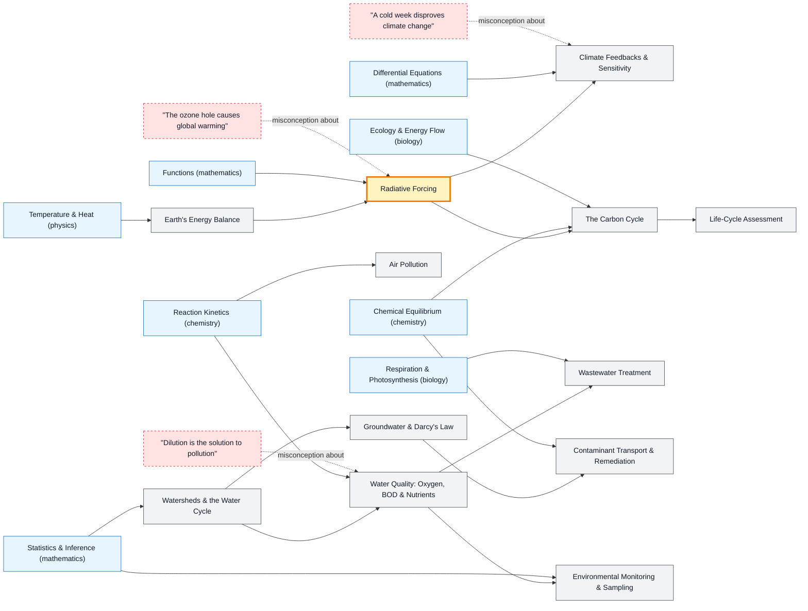

# Environmental Science & Engineering map

_Generated by `python scripts/dulta.py render` from `maps/environmental.json`. Edit the JSON, not this file._

Climate, water and pollution, measured and managed. Radiative forcing is the climate threshold (a small, persistent energy imbalance drives large, slow warming); for water, the threshold is load and oxygen demand rather than concentration alone.

Solid arrows: prerequisite (A grounds B). Dotted arrows: a misconception that blocks the concept it points at. Thick amber nodes are threshold concepts (Meyer & Land): transformative, troublesome, irreversible.

| Node | Kind | Outcome | Retrieval check |
|---|---|---|---|
| `energybalance` Earth's Energy Balance | concept | Compute Earth's effective temperature from the energy balance. | Without an atmosphere Earth would average about −18 °C. Why is it about +15 °C instead? |
| `greenhouse` Radiative Forcing | threshold | Compute the forcing from a CO₂ change. | Forcing from CO₂ is about 5.35 ln(C/C₀) W/m². What is the forcing for a doubling? |
| `misc-ozone` "The ozone hole causes global warming" | misconception | Distinguish ozone depletion from greenhouse warming. | Is the ozone hole the main cause of global warming? |
| `feedbacks` Climate Feedbacks & Sensitivity | concept | Compute equilibrium warming from forcing and the feedback parameter. | Why does melting sea ice amplify warming? |
| `misc-weather` "A cold week disproves climate change" | misconception | Separate a weather event from a climate trend. | Does a record cold week disprove global warming? |
| `carbon` The Carbon Cycle | concept | Trace emitted carbon through its sinks. | Roughly what fraction of emitted CO₂ stays in the atmosphere, with oceans and land taking the rest? |
| `watershed` Watersheds & the Water Cycle | concept | Delineate a watershed and write its water balance. | What is a watershed (catchment)? |
| `waterquality` Water Quality: Oxygen, BOD & Nutrients | concept | Predict the oxygen sag downstream of a sewage outfall. | Why can untreated sewage kill fish even if it isn't toxic? |
| `misc-dilution` "Dilution is the solution to pollution" | misconception | Explain why load, not concentration alone, governs impact. | Why isn't discharging into a big river a safe answer to pollution? |
| `treatment` Wastewater Treatment | concept | Describe each stage of a treatment plant and what it removes. | What do microbes do in the secondary (activated sludge) stage? |
| `groundwater` Groundwater & Darcy's Law | concept | Compute groundwater flow with Darcy's law. | Darcy's law: flow is proportional to hydraulic conductivity times what? |
| `remediation` Contaminant Transport & Remediation | concept | Choose a remediation strategy for a contaminated aquifer. | Why is pump-and-treat often slow to clean up a contaminated aquifer? |
| `air` Air Pollution | concept | Explain how ground-level ozone forms. | Why is ground-level ozone worst on hot, sunny afternoons? |
| `monitoring` Environmental Monitoring & Sampling | concept | Design a sampling plan that can detect a trend. | Why sample a river at fixed times and places over months instead of once? |
| `lca` Life-Cycle Assessment | concept | Compare two products over their life cycles. | Why can an electric car have higher emissions than a petrol car in its first year of use? |

Sources: IPCC AR6 Working Group I: The Physical Science Basis (2021); Hartmann: Global Physical Climatology; Davis & Masten: Principles of Environmental Engineering and Science; Chapra: Surface Water-Quality Modeling; Fetter: Applied Hydrogeology
