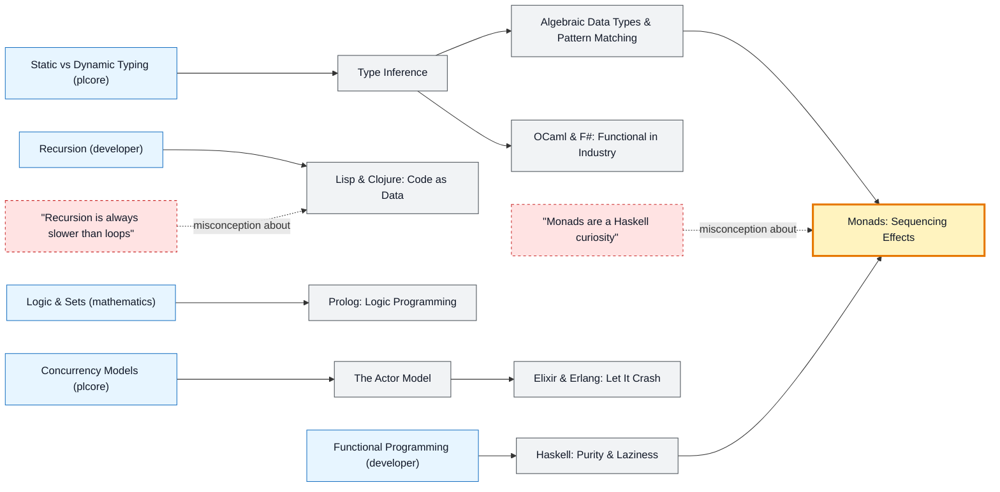

# Functional & Logic Languages map

_Generated by `python scripts/dulta.py render` from `maps/funclang.json`. Edit the JSON, not this file._

Haskell, OCaml, F#, Elixir, Erlang, Clojure and Prolog: languages that treat programs as expressions, messages or logic. Monads are the threshold: a way to sequence effects in a pure language, and a pattern you already use as promises and optionals.

Solid arrows: prerequisite (A grounds B). Dotted arrows: a misconception that blocks the concept it points at. Thick amber nodes are threshold concepts (Meyer & Land): transformative, troublesome, irreversible.

| Node | Kind | Outcome | Retrieval check |
|---|---|---|---|
| `lazy` Haskell: Purity & Laziness | concept | Use an infinite list safely because of laziness. | In Haskell, when is an expression evaluated? |
| `infer` Type Inference | concept | Read an inferred type signature and explain it. | In OCaml or Haskell, must you annotate the type of every function? |
| `adts` Algebraic Data Types & Pattern Matching | concept | Model a domain with sum types and exhaustive matches. | What does the compiler check when you pattern-match on a sum type such as Maybe or Option? |
| `monads` Monads: Sequencing Effects | threshold | Chain Maybe and IO computations with do-notation. | Why does Haskell need something like the IO monad at all? |
| `misc-monad` "Monads are a Haskell curiosity" | misconception | Recognise monadic patterns in mainstream code. | Name a monad-like pattern you can use in mainstream languages. |
| `actors` The Actor Model | concept | Design a system of communicating processes. | How do Erlang and Elixir processes share data? |
| `elixir` Elixir & Erlang: Let It Crash | concept | Build a supervision tree that restarts failed workers. | What does 'let it crash' mean on the BEAM? |
| `lisp` Lisp & Clojure: Code as Data | concept | Write a small macro in Clojure or Scheme. | What does 'homoiconic' mean for Lisp? |
| `misc-tailcall` "Recursion is always slower than loops" | misconception | Rewrite a recursive function in tail-recursive form. | Why doesn't a tail-recursive function grow the stack in Haskell, OCaml or Scheme? |
| `ocaml` OCaml & F#: Functional in Industry | concept | Write a small parser in OCaml or F#. | Which platform does F# run on? |
| `prolog` Prolog: Logic Programming | concept | Write a family-tree program and query it. | In Prolog, what do you write instead of step-by-step instructions? |

Sources: Lipovača: Learn You a Haskell for Great Good!; Minsky, Madhavapeddy, Hickey: Real World OCaml; Armstrong: Programming Erlang; Hickey: Simple Made Easy (2011); Sterling & Shapiro: The Art of Prolog
