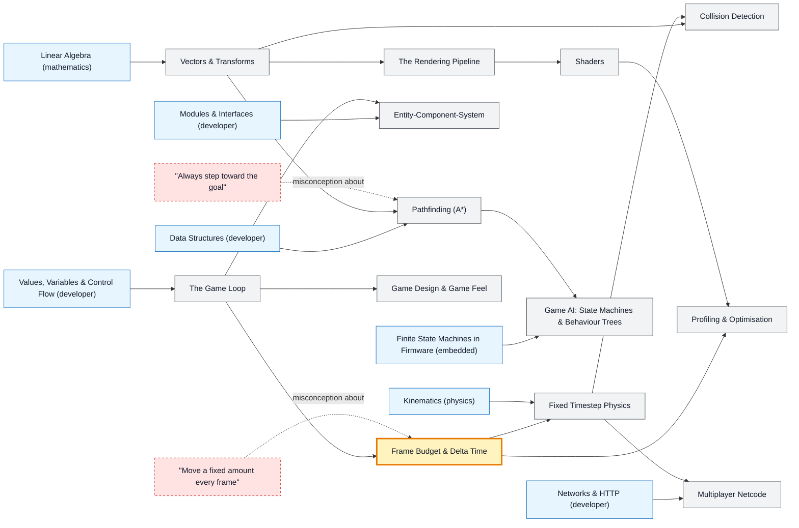

# Game Development map

_Generated by `python scripts/dulta.py render` from `maps/gamedev.json`. Edit the JSON, not this file._

Real-time interactive simulation. The threshold is the frame budget: everything (input, physics, AI, rendering) must fit in about 16 ms, sixty times a second, and the game must behave the same at any frame rate.

Solid arrows: prerequisite (A grounds B). Dotted arrows: a misconception that blocks the concept it points at. Thick amber nodes are threshold concepts (Meyer & Land): transformative, troublesome, irreversible.

| Node | Kind | Outcome | Retrieval check |
|---|---|---|---|
| `loop` The Game Loop | concept | Write a game loop and name its three phases. | What are the three phases of a classic game loop? |
| `framebudget` Frame Budget & Delta Time | threshold | Make movement frame-rate independent with delta time. | How many milliseconds does one frame have at 60 fps? |
| `misc-perframe` "Move a fixed amount every frame" | misconception | Explain and fix frame-rate-dependent movement. | A character moves 5 pixels per frame. What happens on a 144 Hz monitor compared with 60 Hz? |
| `fixedstep` Fixed Timestep Physics | concept | Implement an accumulator loop with a fixed physics step. | Why run physics at a fixed timestep instead of the variable frame time? |
| `transforms` Vectors & Transforms | concept | Use a dot product to decide whether an enemy is in front of the player. | The dot product of the player's facing direction and the direction to an enemy is negative. Where is the enemy? |
| `collision` Collision Detection | concept | Write an AABB overlap test and explain tunnelling. | Why can a fast bullet pass through a thin wall without colliding? |
| `rendering` The Rendering Pipeline | concept | Trace a triangle through vertex shading, rasterisation and fragment shading. | What does the depth buffer (z-buffer) decide? |
| `shaders` Shaders | concept | Write a fragment shader that tints by distance. | Why are shaders fast at per-pixel work? |
| `ecs` Entity-Component-System | concept | Model a game object with components instead of an inheritance tree. | What problem with deep inheritance does ECS avoid? |
| `pathfinding` Pathfinding (A*) | concept | Run A* on a grid and explain the role of the heuristic. | What must be true of A*'s heuristic for it to guarantee the shortest path? |
| `misc-greedy` "Always step toward the goal" | misconception | Show a map where greedy movement fails and A* succeeds. | An enemy always moves to the tile closest to the player. What happens at a U-shaped wall between them? |
| `gameai` Game AI: State Machines & Behaviour Trees | concept | Build a guard's patrol–chase–search behaviour as a state machine. | Why do game studios often prefer behaviour trees to large state machines? |
| `netcode` Multiplayer Netcode | concept | Explain client prediction and reconciliation for a moving player. | Why does the server, not the client, decide what really happened in a competitive game? |
| `profiling` Profiling & Optimisation | concept | Use a profiler to find whether a frame is CPU- or GPU-bound. | Lowering the resolution doesn't raise your frame rate. What does that suggest? |
| `design` Game Design & Game Feel | concept | Define a core loop and run a playtest that changes it. | Why watch playtesters silently instead of explaining the game to them? |

Sources: Nystrom: Game Programming Patterns; Gregory: Game Engine Architecture; Millington: AI for Games; Ericson: Real-Time Collision Detection; Fiedler: Fix Your Timestep! (2004)
