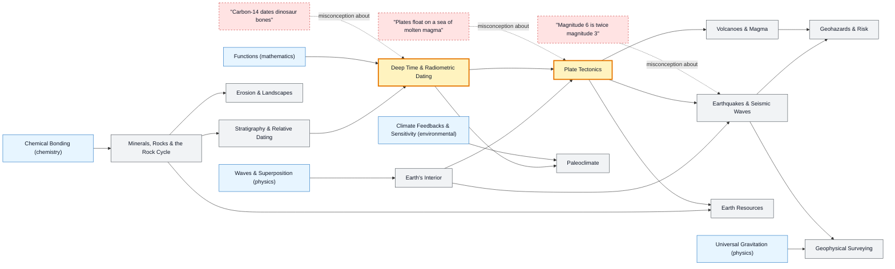

# Geoscience map

_Generated by `python scripts/dulta.py render` from `maps/geoscience.json`. Edit the JSON, not this file._

Reading the Earth's record and its moving parts. Deep time and plate tectonics are the thresholds: once a learner can think in millions of years and in slowly flowing solid rock, mountains, earthquakes, ores and climate history all fit one story.

Solid arrows: prerequisite (A grounds B). Dotted arrows: a misconception that blocks the concept it points at. Thick amber nodes are threshold concepts (Meyer & Land): transformative, troublesome, irreversible.

| Node | Kind | Outcome | Retrieval check |
|---|---|---|---|
| `rocks` Minerals, Rocks & the Rock Cycle | concept | Explain each path through the rock cycle. | How does a sedimentary rock become a metamorphic one? |
| `stratigraphy` Stratigraphy & Relative Dating | concept | Order the events in a geological cross-section. | In undisturbed sedimentary layers, which layer is oldest? |
| `dating` Deep Time & Radiometric Dating | threshold | Compute an age from the fraction of parent isotope remaining. | A rock retains 25% of its original parent isotope. How many half-lives have passed? |
| `misc-c14` "Carbon-14 dates dinosaur bones" | misconception | Choose a dating method suited to an age range. | Why can't carbon-14 date a 66-million-year-old dinosaur bone? |
| `interior` Earth's Interior | concept | Use seismic shadow zones to infer the core's structure. | How do we know Earth's outer core is liquid? |
| `tectonics` Plate Tectonics | threshold | Explain features at divergent, convergent and transform boundaries. | What mainly drives tectonic plates? |
| `misc-magma` "Plates float on a sea of molten magma" | misconception | Describe the mantle's state correctly. | Is the mantle beneath the plates mostly liquid magma? |
| `quakes` Earthquakes & Seismic Waves | concept | Locate an epicentre from three seismograms. | A station records P and S arrivals 20 s apart. With vp = 6 km/s and vs = 3.5 km/s, how far away is the earthquake? |
| `misc-magnitude` "Magnitude 6 is twice magnitude 3" | misconception | Compare earthquake energies across magnitudes. | How much more energy does a magnitude 7 earthquake release than a magnitude 6? |
| `volcanoes` Volcanoes & Magma | concept | Predict eruption style from magma composition. | Why do silica-rich magmas erupt explosively? |
| `landscapes` Erosion & Landscapes | concept | Identify landforms by their processes. | Why are V-shaped valleys usually cut by rivers and U-shaped valleys by glaciers? |
| `resources` Earth Resources | concept | Explain how a petroleum trap forms. | Why do oil and gas accumulate in traps? |
| `hazards` Geohazards & Risk | concept | Assess risk for a town near an active fault. | Why is risk not the same as hazard? |
| `paleoclimate` Paleoclimate | concept | Read temperature and CO₂ from an ice-core record. | How do ice cores record past temperature and CO₂? |
| `geophysics` Geophysical Surveying | concept | Choose a survey method for a buried target. | How can a gravity survey find a buried ore body? |

Sources: Grotzinger & Jordan: Understanding Earth; Stein & Wysession: An Introduction to Seismology, Earthquakes, and Earth Structure; Fowler: The Solid Earth; Ruddiman: Earth's Climate: Past and Future; Dickin: Radiogenic Isotope Geology
