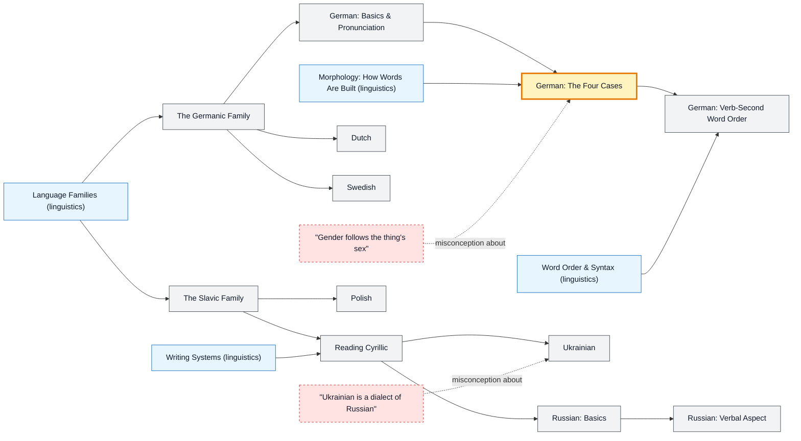

# Germanic & Slavic Languages map

_Generated by `python scripts/dulta.py render` from `maps/germanicslavic.json`. Edit the JSON, not this file._

German, Dutch, Swedish, Russian, Polish and Ukrainian. Case is the shared threshold: when nouns change form for their role in the sentence, word order loosens and endings carry the meaning.

Solid arrows: prerequisite (A grounds B). Dotted arrows: a misconception that blocks the concept it points at. Thick amber nodes are threshold concepts (Meyer & Land): transformative, troublesome, irreversible.

| Node | Kind | Outcome | Retrieval check |
|---|---|---|---|
| `germanic` The Germanic Family | concept | Recognise Germanic cognates with English. | English, German, Dutch and Swedish share an ancestor called what? |
| `de-basics` German: Basics & Pronunciation | concept | Greet and introduce yourself in German. | How do you say 'good morning' in German? |
| `de-cases` German: The Four Cases | threshold | Choose the right article for each case. | Name German's four grammatical cases. |
| `misc-de-gender` "Gender follows the thing's sex" | misconception | Predict gender from noun endings. | What is the grammatical gender of German 'das Mädchen' (the girl)? |
| `de-v2` German: Verb-Second Word Order | concept | Build main and subordinate clauses with correct verb position. | In a German main clause, where does the conjugated verb go? |
| `nl` Dutch | concept | Read simple Dutch using English and German cognates. | How do you say 'thank you' in Dutch? |
| `sv` Swedish | concept | Use Swedish's suffixed definite article. | How do you say 'thank you' in Swedish? |
| `slavic` The Slavic Family | concept | Place a Slavic language in its branch. | Russian, Polish, Czech and Ukrainian belong to which branch of Indo-European? |
| `cyrillic` Reading Cyrillic | concept | Read Cyrillic words aloud. | Read the Cyrillic word 'Москва'. Which city is it? |
| `ru-basics` Russian: Basics | concept | Greet and thank in Russian. | How do you say 'thank you' in Russian? |
| `ru-aspect` Russian: Verbal Aspect | concept | Choose the right aspect in past and future. | Russian verbs come in pairs like читать / прочитать. What distinction do the two aspects express? |
| `pl` Polish | concept | Decline a Polish noun through its cases. | How many grammatical cases does Polish have? |
| `uk` Ukrainian | concept | Greet and thank in Ukrainian and read its distinctive letters. | How do you say 'thank you' in Ukrainian? |
| `misc-ru-uk` "Ukrainian is a dialect of Russian" | misconception | Explain why Ukrainian is a language, not a dialect. | Is Ukrainian a dialect of Russian? |

Sources: Durrell: Hammer's German Grammar and Usage; Wade: A Comprehensive Russian Grammar; Swan & Smith: Learner English (contrastive notes); Comrie & Corbett: The Slavonic Languages; König & van der Auwera: The Germanic Languages
