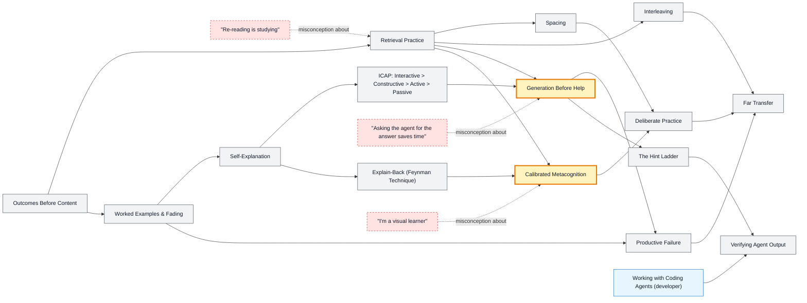

# Learning with Agents map

_Generated by `python scripts/dulta.py render` from `maps/learning.json`. Edit the JSON, not this file._

The meta-map: how to learn anything with an AI agent beside you without letting it do the learning for you. Its two thresholds are generation before help, and calibrated metacognition: knowing what you know, measured rather than felt.

Solid arrows: prerequisite (A grounds B). Dotted arrows: a misconception that blocks the concept it points at. Thick amber nodes are threshold concepts (Meyer & Land): transformative, troublesome, irreversible.

| Node | Kind | Outcome | Retrieval check |
|---|---|---|---|
| `goals` Outcomes Before Content | concept | Rewrite a vague goal as a testable outcome. | Rewrite 'understand recursion' as a testable outcome. |
| `retrieval` Retrieval Practice | concept | Replace a re-reading session with a self-test session. | Which produces better retention a week later: re-reading a chapter twice, or reading once and self-testing? |
| `misc-reread` "Re-reading is studying" | misconception | Explain why familiarity is not recall. | Why does re-reading feel effective? |
| `spacing` Spacing | concept | Schedule reviews at expanding intervals (e.g. 1, 3, 7, 16 days). | Three hours of study: one block the night before, or three one-hour blocks across a week? |
| `interleaving` Interleaving | concept | Design a mixed practice set across three topics. | Why does interleaved practice feel worse but test better? |
| `worked` Worked Examples & Fading | concept | Build a faded sequence: full example, partial example, solo problem. | For a complete novice, is it better to start with a worked example or an unaided problem? |
| `selfexplain` Self-Explanation | concept | Annotate a worked example with the reason for each step. | What question do you ask at each step of a worked example? |
| `icap` ICAP: Interactive > Constructive > Active > Passive | concept | Classify a study activity by ICAP mode and upgrade it one level. | Highlighting a textbook is which ICAP mode? |
| `generation` Generation Before Help | threshold | Commit a written attempt and a confidence rating before asking an agent. | Before asking an agent to solve a problem, what should you write down? |
| `misc-answer` "Asking the agent for the answer saves time" | misconception | Set up an agent in hint-only mode for a practice session. | What did unguarded AI help do to unaided exam scores in Bastani et al.? |
| `productive` Productive Failure | concept | Design a struggle phase followed by consolidation. | What must follow the failure phase for it to be productive? |
| `hints` The Hint Ladder | concept | Write a four-rung hint ladder for one problem. | What is the first rung of a good hint ladder? |
| `feynman` Explain-Back (Feynman Technique) | concept | Explain a concept in under 150 plain words and mark the gaps. | What signals a gap during explain-back? |
| `metacog` Calibrated Metacognition | threshold | Track confidence versus correctness over a set and compute calibration. | You were 90% confident on 10 answers and got 6 right. What does that say? |
| `misc-styles` "I'm a visual learner" | misconception | Choose a representation by what the content is. | Should a map of a city be taught as text to an 'auditory learner'? |
| `deliberate` Deliberate Practice | concept | Design a practice block targeting one weak sub-skill with feedback. | What separates deliberate practice from repetition? |
| `verify` Verifying Agent Output | concept | Verify an agent's derivation by an independent route. | An agent gives a formula. Name two independent checks. |
| `transfer` Far Transfer | concept | Solve a problem from a different domain with a learned principle. | Why are textbook end-of-chapter problems a weak test of transfer? |

Sources: Brown, Roediger, McDaniel: Make It Stick; Bjork & Bjork: Desirable difficulties (2011); Chi & Wylie: The ICAP framework (2014); Kapur: Productive failure (2008); Bastani et al.: Generative AI without guardrails can harm learning (PNAS, 2025); Pashler et al.: Learning styles: concepts and evidence (2008)
