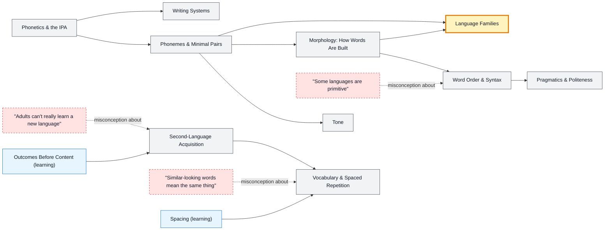

# How Languages Work map

_Generated by `python scripts/dulta.py render` from `maps/linguistics.json`. Edit the JSON, not this file._

The toolkit behind every language map: sounds, words, word order, writing systems and how adults actually acquire a language. Its threshold is the idea that every human language is fully rule-governed and expressive; the differences are in where the complexity sits.

Solid arrows: prerequisite (A grounds B). Dotted arrows: a misconception that blocks the concept it points at. Thick amber nodes are threshold concepts (Meyer & Land): transformative, troublesome, irreversible.

| Node | Kind | Outcome | Retrieval check |
|---|---|---|---|
| `ipa` Phonetics & the IPA | concept | Transcribe a short word in the IPA. | Why do linguists use the IPA instead of ordinary spelling? |
| `phonemes` Phonemes & Minimal Pairs | concept | Find minimal pairs that prove two sounds are separate phonemes. | 'Ship' and 'sheep' differ by one sound. What is such a pair called? |
| `tones` Tone | concept | Explain how tone distinguishes words in Mandarin, Vietnamese, Thai or Yoruba. | In Mandarin, what changes when you change the pitch contour of 'ma'? |
| `morphology` Morphology: How Words Are Built | concept | Segment words into morphemes and classify a language's morphology. | How many morphemes are in 'unhappiness'? |
| `syntax` Word Order & Syntax | concept | Predict other word-order features from a language's basic order. | English is SVO. What is the basic word order of Japanese, Korean, Hindi and Turkish? |
| `misc-primitive` "Some languages are primitive" | misconception | Refute the idea of primitive languages with examples. | Are there 'primitive' human languages with simpler, less complete grammar? |
| `families` Language Families | threshold | Place a language in its family and branch. | Hindi, Persian, Russian, Spanish and English all belong to which language family? |
| `writing` Writing Systems | concept | Classify a script and say what it writes. | What is the difference between an alphabet and an abjad? |
| `pragmatics` Pragmatics & Politeness | concept | Choose the right register for a situation in another language. | Why is answering 'Can you pass the salt?' with 'Yes' (and not passing it) a joke? |
| `sla` Second-Language Acquisition | concept | Design a week of study that balances input, output and review. | What does Krashen's comprehensible-input hypothesis claim? |
| `misc-adults` "Adults can't really learn a new language" | misconception | Set realistic goals for adult learners. | Can adults learn a second language to a high level? |
| `vocab` Vocabulary & Spaced Repetition | concept | Build a frequency-ordered, spaced vocabulary plan. | Roughly how many of the most frequent word families cover the large majority of everyday text? |
| `misc-falsefriends` "Similar-looking words mean the same thing" | misconception | Spot common false friends between English and a target language. | What does Spanish 'embarazada' mean? |

Sources: Yule: The Study of Language; Ladefoged & Johnson: A Course in Phonetics; Krashen: Principles and Practice in Second Language Acquisition (1982); Nation: Learning Vocabulary in Another Language; WALS: The World Atlas of Language Structures (Dryer & Haspelmath)
