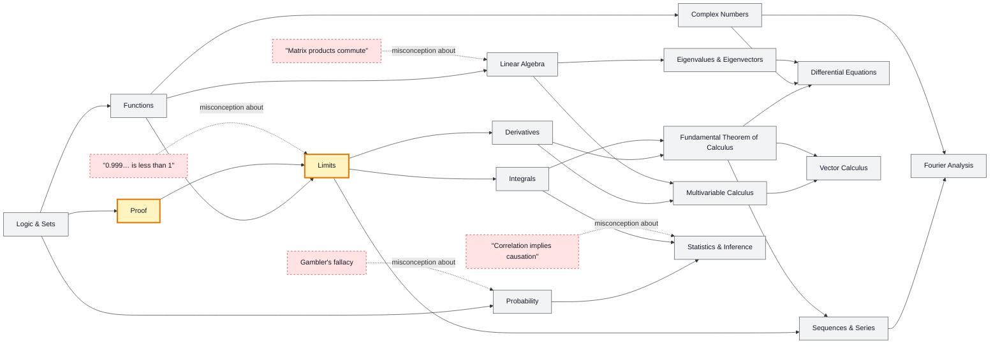

# Mathematics map

_Generated by `python scripts/dulta.py render` from `maps/mathematics.json`. Edit the JSON, not this file._

The language the other maps are written in. Proof and the limit are the two thresholds: after proof, mathematics is argument rather than procedure; after the limit, the infinite becomes something you can compute with.

Solid arrows: prerequisite (A grounds B). Dotted arrows: a misconception that blocks the concept it points at. Thick amber nodes are threshold concepts (Meyer & Land): transformative, troublesome, irreversible.

| Node | Kind | Outcome | Retrieval check |
|---|---|---|---|
| `logic` Logic & Sets | concept | Negate a statement with nested quantifiers. | Negate: 'every student passed some exam'. |
| `proof` Proof | threshold | Write a proof by induction. | Why do 1,000 checked cases not prove that n² + n + 41 is always prime? |
| `functions` Functions | concept | Find the inverse of a function and state its domain. | Is x ↦ x² from ℝ to ℝ invertible? |
| `misc-point9` "0.999… is less than 1" | misconception | Prove 0.999… = 1 two different ways. | What number lies strictly between 0.999… and 1? |
| `limits` Limits | threshold | Evaluate a limit and justify it with ε–δ for a linear function. | What is lim(x→0) sin(x)/x? |
| `derivatives` Derivatives | concept | Differentiate with the chain rule and interpret the result as a rate. | Position is x(t) = 3t². What is the velocity at t = 2? |
| `integrals` Integrals | concept | Compute a definite integral and interpret it as accumulated change. | Velocity is constant at 5 m/s for 4 s. What does ∫v dt give? |
| `ftc` Fundamental Theorem of Calculus | concept | Use the FTC to differentiate an integral with a variable upper limit. | What is d/dx ∫₀ˣ cos(t) dt? |
| `series` Sequences & Series | concept | Test a series for convergence; write a Taylor polynomial. | Does 1 + 1/2 + 1/3 + 1/4 + … converge? |
| `linalg` Linear Algebra | concept | Solve a linear system and interpret it as a matrix equation. | Is the set of solutions to Ax = 0 always a vector space? |
| `misc-commute` "Matrix products commute" | misconception | Give a 2×2 counterexample to AB = BA. | Rotate then reflect versus reflect then rotate: same result? |
| `eigen` Eigenvalues & Eigenvectors | concept | Diagonalize a 2×2 matrix. | What are the eigenvalues of [[2,0],[0,3]]? |
| `complex` Complex Numbers | concept | Multiply complex numbers in polar form. | What does multiplying by i do geometrically? |
| `diffeq` Differential Equations | concept | Solve x″ = −ω²x and interpret the solution. | What functions satisfy y′ = y? |
| `multivar` Multivariable Calculus | concept | Find the direction of steepest ascent with the gradient. | What does ∇f point toward? |
| `vectorcalc` Vector Calculus | concept | Apply the divergence theorem to a flux integral. | What does a nonzero divergence at a point mean physically? |
| `fourier` Fourier Analysis | concept | Synthesize a square wave from odd harmonics. | Which harmonics make up a square wave? |
| `probability` Probability | concept | Apply Bayes' theorem to a diagnostic-test problem. | A test is 99% accurate for a disease with 1% prevalence. You test positive. Roughly how likely is it you have it? |
| `misc-gambler` Gambler's fallacy | misconception | Explain independence with a coin-flip sequence. | A fair coin lands heads 6 times running. Probability of heads next? |
| `statistics` Statistics & Inference | concept | Interpret a confidence interval correctly. | Does a p-value of 0.03 mean a 3% chance the null hypothesis is true? |
| `misc-corr` "Correlation implies causation" | misconception | Name a confounder for a given correlation. | Ice-cream sales correlate with drownings. Why? |

Sources: Velleman: How to Prove It; Spivak: Calculus; Strang: Introduction to Linear Algebra; Pólya: How to Solve It; Tall & Vinner: Concept image and concept definition (1981)
