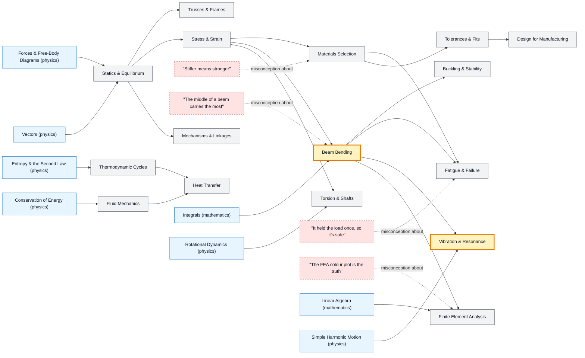

# Mechanical Engineering map

_Generated by `python scripts/dulta.py render` from `maps/mechanical.json`. Edit the JSON, not this file._

Forces into structures, structures into machines. Bending (stress varies across a section) and resonance (a small push at the right frequency breaks big things) are the thresholds; the rest is learning to trust a model only as far as its assumptions.

Solid arrows: prerequisite (A grounds B). Dotted arrows: a misconception that blocks the concept it points at. Thick amber nodes are threshold concepts (Meyer & Land): transformative, troublesome, irreversible.

| Node | Kind | Outcome | Retrieval check |
|---|---|---|---|
| `statics` Statics & Equilibrium | concept | Find support reactions of a loaded beam. | A 4 m beam on supports at each end carries 1000 N at its middle. What is each reaction? |
| `trusses` Trusses & Frames | concept | Find member forces by the method of joints. | Why do truss members carry only axial force? |
| `stress` Stress & Strain | concept | Compute the elongation of a loaded rod. | A steel rod (E = 200 GPa) carries 100 MPa of stress. What is its strain? |
| `misc-stiff` "Stiffer means stronger" | misconception | Distinguish stiffness, strength and toughness with examples. | Which is stiffer, aluminium or a typical steel, and is the stiffer one always stronger? |
| `materials` Materials Selection | concept | Choose a material for a light, stiff beam using a performance index. | For a light, stiff beam in bending, which index is maximised? |
| `beams` Beam Bending | threshold | Compute maximum bending stress with σ = My/I. | Why is a plank much stiffer on edge than flat? |
| `misc-middle` "The middle of a beam carries the most" | misconception | Explain the shape of an I-beam from the stress distribution. | Where in a beam's cross-section is bending stress largest? |
| `torsion` Torsion & Shafts | concept | Size a shaft to transmit a given power. | Why are drive shafts often hollow? |
| `buckling` Buckling & Stability | concept | Compute the Euler buckling load of a column. | If you double a column's length, what happens to its Euler buckling load? |
| `fatigue` Fatigue & Failure | concept | Estimate fatigue life from an S–N curve and a stress concentration factor. | Why do aircraft windows have rounded corners? |
| `misc-once` "It held the load once, so it's safe" | misconception | Explain why a static test does not prove fatigue life. | A paperclip doesn't break when bent once. Why does it break after bending back and forth? |
| `vibration` Vibration & Resonance | threshold | Compute a natural frequency and choose a design that avoids resonance. | A mass on a spring has a natural frequency of 10 Hz. A motor vibrates it at 10 Hz. What happens, and what are two fixes? |
| `mechanisms` Mechanisms & Linkages | concept | Compute a gear train ratio and a linkage's degrees of freedom. | A 20-tooth gear drives a 60-tooth gear. Output speed and torque compared with input? |
| `thermocycles` Thermodynamic Cycles | concept | Compute the Carnot efficiency between two temperatures. | What is the maximum efficiency of an engine running between 600 K and 300 K? |
| `fluids` Fluid Mechanics | concept | Predict laminar or turbulent flow from the Reynolds number. | What does a high Reynolds number indicate? |
| `heat` Heat Transfer | concept | Compute heat loss through a composite wall. | Why does a double-glazed window lose less heat than a single pane? |
| `tolerances` Tolerances & Fits | concept | Choose a fit for a bearing on a shaft and stack up tolerances. | Why specify a tolerance at all instead of the exact size? |
| `dfm` Design for Manufacturing | concept | Revise a part for injection moulding or 3D printing. | Why do injection-moulded parts have draft angles? |
| `fea` Finite Element Analysis | concept | Run an FEA, check mesh convergence and compare with a hand calculation. | Your FEA shows a stress 'hot spot' at a sharp re-entrant corner that grows with every mesh refinement. What is happening? |
| `misc-fea` "The FEA colour plot is the truth" | misconception | Validate an FEA with an independent hand estimate. | Name two independent checks before trusting an FEA result. |

Sources: Hibbeler: Engineering Mechanics: Statics and Dynamics; Gere & Goodno: Mechanics of Materials; Shigley: Mechanical Engineering Design; Ashby: Materials Selection in Mechanical Design; Gordon: Structures, or Why Things Don't Fall Down
