# Machine Learning & AI map

_Generated by `python scripts/dulta.py render` from `maps/ml.json`. Edit the JSON, not this file._

Learning functions from data. Two thresholds: optimisation (a model is a loss surface you walk downhill) and generalisation (only performance on unseen data counts). Everything from linear regression to transformers sits on those two ideas.

Solid arrows: prerequisite (A grounds B). Dotted arrows: a misconception that blocks the concept it points at. Thick amber nodes are threshold concepts (Meyer & Land): transformative, troublesome, irreversible.

```mermaid
flowchart LR
  ml__data["Data, Features & Splits"]:::concept
  ml__regression["Linear Regression & Loss"]:::concept
  ml__gradient["Gradient Descent"]:::threshold
  ml__overfitting["Overfitting & Generalisation"]:::threshold
  ml__misc_train["#quot;Higher training accuracy means a better model#quot;"]:::misconception
  ml__regularization["Regularisation"]:::concept
  ml__classification["Classification & Logistic Regression"]:::concept
  ml__metrics["Evaluation Metrics"]:::concept
  ml__misc_accuracy["#quot;Accuracy is always the right metric#quot;"]:::misconception
  ml__neural["Neural Networks"]:::concept
  ml__backprop["Backpropagation"]:::concept
  ml__cnn["Convolutional Networks"]:::concept
  ml__embeddings["Embeddings"]:::concept
  ml__attention["Attention & Transformers"]:::threshold
  ml__llms["Large Language Models"]:::concept
  ml__misc_understand["#quot;The model understands like a person#quot;"]:::misconception
  ml__rl["Reinforcement Learning"]:::concept
  ml__fairness["Bias, Fairness & Responsible AI"]:::concept
  mathematics__derivatives["Derivatives (mathematics)"]:::external
  mathematics__linalg["Linear Algebra (mathematics)"]:::external
  mathematics__multivar["Multivariable Calculus (mathematics)"]:::external
  mathematics__probability["Probability (mathematics)"]:::external
  mathematics__statistics["Statistics & Inference (mathematics)"]:::external
  mathematics__statistics --> ml__data
  ml__data --> ml__regression
  mathematics__linalg --> ml__regression
  ml__regression --> ml__gradient
  mathematics__multivar --> ml__gradient
  ml__gradient --> ml__overfitting
  ml__data --> ml__overfitting
  ml__misc_train -.->|misconception about| ml__overfitting
  ml__overfitting --> ml__regularization
  ml__regression --> ml__classification
  mathematics__probability --> ml__classification
  ml__classification --> ml__metrics
  ml__misc_accuracy -.->|misconception about| ml__metrics
  ml__classification --> ml__neural
  ml__gradient --> ml__neural
  ml__neural --> ml__backprop
  mathematics__derivatives --> ml__backprop
  ml__backprop --> ml__cnn
  ml__neural --> ml__embeddings
  ml__embeddings --> ml__attention
  ml__backprop --> ml__attention
  ml__attention --> ml__llms
  ml__misc_understand -.->|misconception about| ml__llms
  ml__gradient --> ml__rl
  mathematics__probability --> ml__rl
  ml__metrics --> ml__fairness
  ml__data --> ml__fairness
  classDef concept fill:#f1f3f5,stroke:#495057,color:#111827
  classDef threshold fill:#fff3bf,stroke:#e67700,stroke-width:3px,color:#111827
  classDef misconception fill:#ffe3e3,stroke:#c92a2a,stroke-dasharray:4,color:#111827
  classDef external fill:#e7f5ff,stroke:#1971c2,color:#111827
  classDef mastered fill:#d3f9d8,stroke:#2b8a3e,color:#111827
  classDef frontier fill:#ffffff,stroke:#111827,stroke-width:3px,color:#111827
```

| Node | Kind | Outcome | Retrieval check |
|---|---|---|---|
| `data` Data, Features & Splits | concept | Split a dataset correctly and explain what each split is for. | What is the test set for, and when may you look at it? |
| `regression` Linear Regression & Loss | concept | Fit a linear model and interpret its loss. | Why is mean squared error sensitive to outliers? |
| `gradient` Gradient Descent | threshold | Run gradient descent by hand for two steps and choose a learning rate. | What happens if the learning rate is far too large? |
| `overfitting` Overfitting & Generalisation | threshold | Diagnose overfitting from training and validation curves. | Training error keeps falling while validation error rises. What is happening? |
| `misc-train` "Higher training accuracy means a better model" | misconception | Choose between two models using validation, not training, scores. | Model A: 99% train, 70% validation. Model B: 88% train, 86% validation. Which do you deploy? |
| `regularization` Regularisation | concept | Add L2 regularisation and explain its effect on the weights. | What does an L2 penalty do to a model's weights? |
| `classification` Classification & Logistic Regression | concept | Train a logistic classifier and read its decision boundary. | Why use cross-entropy rather than squared error for classification? |
| `metrics` Evaluation Metrics | concept | Choose a metric for an imbalanced problem and justify it. | 99% of transactions are legitimate. A model predicts 'legitimate' every time. What is its accuracy, and why is that useless? |
| `misc-accuracy` "Accuracy is always the right metric" | misconception | Show where accuracy misleads. | When does accuracy mislead most? |
| `neural` Neural Networks | concept | Compute a forward pass through a two-layer network. | Why does a deep network need nonlinear activation functions? |
| `backprop` Backpropagation | concept | Backpropagate gradients through a small graph by hand. | Which rule of calculus is backpropagation built on? |
| `cnn` Convolutional Networks | concept | Compute a convolution's output size and parameter count. | Why does a CNN need far fewer parameters than a fully connected layer on an image? |
| `embeddings` Embeddings | concept | Use cosine similarity on embeddings to find related items. | Why use cosine similarity rather than raw distance to compare embeddings? |
| `attention` Attention & Transformers | threshold | Compute scaled dot-product attention for three tokens. | What do the softmax weights in attention decide? |
| `llms` Large Language Models | concept | Explain pre-training, fine-tuning and RLHF and what each changes. | What objective is a base language model pre-trained on? |
| `misc-understand` "The model understands like a person" | misconception | Design a check that exposes a fluent but wrong answer. | Why can an LLM state a false fact confidently? |
| `rl` Reinforcement Learning | concept | Explain the exploration–exploitation trade-off with a bandit example. | Why must an RL agent sometimes take an action it currently believes is worse? |
| `fairness` Bias, Fairness & Responsible AI | concept | Audit a classifier's error rates across groups. | A hiring model is trained on past hiring decisions. What risk does that carry? |

Sources: Goodfellow, Bengio, Courville: Deep Learning; Bishop: Pattern Recognition and Machine Learning; Hastie, Tibshirani, Friedman: The Elements of Statistical Learning; Vaswani et al.: Attention Is All You Need (2017); Sutton & Barto: Reinforcement Learning
