# Physics map

_Generated by `python scripts/dulta.py render` from `maps/physics.json`. Edit the JSON, not this file._

From measurement to quantum fields. The spine is mechanics; five threshold concepts (Newton's laws, conservation of energy, entropy, relativity of simultaneity, quantum states) change how everything after them is seen.

Solid arrows: prerequisite (A grounds B). Dotted arrows: a misconception that blocks the concept it points at. Thick amber nodes are threshold concepts (Meyer & Land): transformative, troublesome, irreversible.

```mermaid
flowchart LR
  physics__measurement["Measurement & Uncertainty"]:::concept
  physics__dimensions["Units & Dimensional Analysis"]:::concept
  physics__vectors["Vectors"]:::concept
  physics__kinematics["Kinematics"]:::concept
  physics__misc_impetus["#quot;Motion needs a force#quot;"]:::misconception
  physics__newton["Newton's Laws"]:::threshold
  physics__misc_heavier["#quot;Heavier falls faster#quot;"]:::misconception
  physics__forces["Forces & Free-Body Diagrams"]:::concept
  physics__misc_centrifugal["#quot;Centrifugal force pushes outward#quot;"]:::misconception
  physics__circular["Circular Motion"]:::concept
  physics__energy["Conservation of Energy"]:::threshold
  physics__work["Work & Power"]:::concept
  physics__momentum["Momentum & Collisions"]:::concept
  physics__rotation["Rotational Dynamics"]:::concept
  physics__gravitation["Universal Gravitation"]:::concept
  physics__shm["Simple Harmonic Motion"]:::concept
  physics__waves["Waves & Superposition"]:::concept
  physics__thermo["Temperature & Heat"]:::concept
  physics__misc_heat["#quot;Heat and temperature are the same#quot;"]:::misconception
  physics__entropy["Entropy & the Second Law"]:::threshold
  physics__statmech["Statistical Mechanics"]:::concept
  physics__electrostatics["Electric Charge & Fields"]:::concept
  physics__misc_current["#quot;Current gets used up#quot;"]:::misconception
  physics__circuits["Circuits"]:::concept
  physics__magnetism["Magnetism & Induction"]:::concept
  physics__maxwell["Maxwell's Equations"]:::concept
  physics__optics["Light & Optics"]:::concept
  physics__relativity["Special Relativity"]:::threshold
  physics__lagrangian["Lagrangian Mechanics"]:::concept
  physics__misc_orbits["#quot;Electrons orbit like planets#quot;"]:::misconception
  physics__quantum["Quantum Mechanics"]:::threshold
  mathematics__derivatives["Derivatives (mathematics)"]:::external
  mathematics__diffeq["Differential Equations (mathematics)"]:::external
  mathematics__linalg["Linear Algebra (mathematics)"]:::external
  mathematics__probability["Probability (mathematics)"]:::external
  mathematics__vectorcalc["Vector Calculus (mathematics)"]:::external
  physics__measurement --> physics__dimensions
  physics__dimensions --> physics__kinematics
  physics__vectors --> physics__kinematics
  mathematics__derivatives --> physics__kinematics
  physics__kinematics --> physics__newton
  physics__misc_impetus -.->|misconception about| physics__newton
  physics__misc_heavier -.->|misconception about| physics__newton
  physics__newton --> physics__forces
  physics__forces --> physics__circular
  physics__misc_centrifugal -.->|misconception about| physics__circular
  physics__forces --> physics__work
  physics__work --> physics__energy
  physics__newton --> physics__momentum
  physics__momentum --> physics__rotation
  physics__circular --> physics__rotation
  physics__circular --> physics__gravitation
  physics__energy --> physics__gravitation
  physics__forces --> physics__shm
  mathematics__diffeq --> physics__shm
  physics__shm --> physics__waves
  physics__energy --> physics__thermo
  physics__misc_heat -.->|misconception about| physics__thermo
  physics__thermo --> physics__entropy
  physics__entropy --> physics__statmech
  mathematics__probability --> physics__statmech
  physics__forces --> physics__electrostatics
  physics__electrostatics --> physics__circuits
  physics__misc_current -.->|misconception about| physics__circuits
  physics__circuits --> physics__magnetism
  physics__magnetism --> physics__maxwell
  mathematics__vectorcalc --> physics__maxwell
  physics__maxwell --> physics__optics
  physics__waves --> physics__optics
  physics__maxwell --> physics__relativity
  physics__energy --> physics__lagrangian
  physics__rotation --> physics__lagrangian
  physics__waves --> physics__quantum
  physics__statmech --> physics__quantum
  mathematics__linalg --> physics__quantum
  physics__misc_orbits -.->|misconception about| physics__quantum
  classDef concept fill:#f1f3f5,stroke:#495057,color:#111827
  classDef threshold fill:#fff3bf,stroke:#e67700,stroke-width:3px,color:#111827
  classDef misconception fill:#ffe3e3,stroke:#c92a2a,stroke-dasharray:4,color:#111827
  classDef external fill:#e7f5ff,stroke:#1971c2,color:#111827
  classDef mastered fill:#d3f9d8,stroke:#2b8a3e,color:#111827
  classDef frontier fill:#ffffff,stroke:#111827,stroke-width:3px,color:#111827
```

| Node | Kind | Outcome | Retrieval check |
|---|---|---|---|
| `measurement` Measurement & Uncertainty | concept | Report a measured quantity with unit and propagated uncertainty. | You time 10 swings of a pendulum as 14.2 s ± 0.2 s. What is the period and its uncertainty? |
| `dimensions` Units & Dimensional Analysis | concept | Derive the form of a law (up to a constant) from dimensions alone. | Using dimensions only, how must a pendulum's period depend on its length L and g? |
| `vectors` Vectors | concept | Resolve a vector into components and add vectors by components. | A 10 N force points 30° above horizontal. What is its horizontal component? |
| `kinematics` Kinematics | concept | Predict the trajectory of a projectile from its launch conditions. | A ball is thrown horizontally off a table while another is dropped from the same height. Which lands first? |
| `misc-impetus` "Motion needs a force" | misconception | State and refute the impetus model with a frictionless counterexample. | A puck slides across frictionless ice at constant velocity. What net force acts on it? |
| `newton` Newton's Laws | threshold | Draw a free-body diagram and apply ΣF = ma to predict motion. | A book rests on a table. Name the Newton's-third-law partner of the gravitational force of Earth on the book. |
| `misc-heavier` "Heavier falls faster" | misconception | Explain why mass cancels in free fall. | In a vacuum, a hammer and a feather are dropped together. Which lands first? |
| `forces` Forces & Free-Body Diagrams | concept | Model a multi-force system and solve for an unknown force. | A 2 kg block hangs from a rope at rest. What is the tension? |
| `misc-centrifugal` "Centrifugal force pushes outward" | misconception | Identify the centripetal force in a circular-motion scenario. | A car rounds a flat curve at constant speed. Which force keeps it on the curve? |
| `circular` Circular Motion | concept | Compute the centripetal force needed for a given speed and radius. | If you double the speed on the same curve, by what factor does the needed force change? |
| `energy` Conservation of Energy | threshold | Solve a motion problem with energy conservation where forces would be awkward. | A ball is released from rest 5 m up a frictionless ramp. What is its speed at the bottom? |
| `work` Work & Power | concept | Compute work done by a variable force as an area under F(x). | You carry a box horizontally at constant velocity. How much work does gravity do on it? |
| `momentum` Momentum & Collisions | concept | Predict final velocities in a 1D collision. | A 1 kg cart at 2 m/s sticks to an identical cart at rest. Final speed? |
| `rotation` Rotational Dynamics | concept | Use τ = Iα and conservation of angular momentum. | A skater pulls in their arms. What happens to the spin rate, and why? |
| `gravitation` Universal Gravitation | concept | Derive orbital speed from F = GMm/r². | Why do astronauts on the ISS float, if gravity there is ~90% of surface gravity? |
| `shm` Simple Harmonic Motion | concept | Predict the period of a spring or small-angle pendulum. | Does a pendulum's period change if you double its mass? |
| `waves` Waves & Superposition | concept | Predict interference maxima from path difference. | Two speakers emit the same tone. You stand where the path difference is half a wavelength. What do you hear? |
| `thermo` Temperature & Heat | concept | Apply the first law of thermodynamics to a gas process. | Metal and wood in the same room feel different temperatures. Are they? |
| `misc-heat` "Heat and temperature are the same" | misconception | Distinguish heat from temperature with a phase-change example. | Ice melts in a glass at 0 °C while absorbing heat. What happens to its temperature? |
| `entropy` Entropy & the Second Law | threshold | Explain irreversibility in terms of counting microstates. | Why does a dropped egg never unscramble, though no law of mechanics forbids it? |
| `statmech` Statistical Mechanics | concept | Use the Boltzmann factor to compare occupation of two energy levels. | As temperature rises, what happens to the ratio of high- to low-energy particles? |
| `electrostatics` Electric Charge & Fields | concept | Compute the field of a point charge and a charged plane. | What is the electric field inside a charged, conducting hollow sphere? |
| `misc-current` "Current gets used up" | misconception | Explain series circuits with charge conservation. | Two bulbs in series: is the current after the second bulb less than before the first? |
| `circuits` Circuits | concept | Analyse a two-loop circuit with Kirchhoff's rules. | Adding a second identical bulb in parallel: does the battery's current rise or fall? |
| `magnetism` Magnetism & Induction | concept | Predict induced current direction with Lenz's law. | A magnet falls through a copper tube. Why does it fall slowly? |
| `maxwell` Maxwell's Equations | concept | Show that Maxwell's equations predict waves travelling at c = 1/√(μ₀ε₀). | What does Maxwell's displacement current fix in Ampère's law? |
| `optics` Light & Optics | concept | Locate an image with the thin-lens equation. | Why does a straw look bent in a glass of water? |
| `relativity` Special Relativity | threshold | Compute time dilation for a moving clock. | A muon lives 2.2 µs at rest but reaches the ground from 15 km up. How? |
| `lagrangian` Lagrangian Mechanics | concept | Derive equations of motion from a Lagrangian. | What is the advantage of generalized coordinates for a bead on a rotating hoop? |
| `misc-orbits` "Electrons orbit like planets" | misconception | Contrast an orbital with an orbit. | Where is the electron in a hydrogen 1s state? |
| `quantum` Quantum Mechanics | threshold | Compute measurement probabilities from a state vector. | A qubit is (|0⟩ + |1⟩)/√2. What is the probability of measuring 1? |

Sources: Halliday, Resnick, Walker: Fundamentals of Physics; Feynman, Leighton, Sands: The Feynman Lectures on Physics; Hestenes, Wells, Swackhamer: Force Concept Inventory (1992); Knight: Five Easy Lessons
