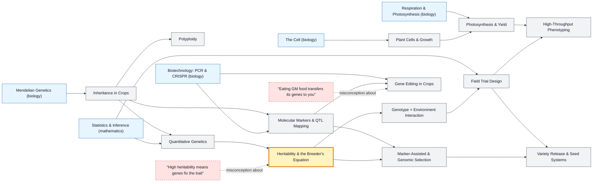

# Plant Science & Genetics map

_Generated by `python scripts/dulta.py render` from `maps/plant.json`. Edit the JSON, not this file._

Breeding better crops with genetics and statistics. Heritability and the breeder's equation are the threshold: they turn 'pick the best plants' into a prediction of how much the next generation will improve, and why the environment can undo it.

Solid arrows: prerequisite (A grounds B). Dotted arrows: a misconception that blocks the concept it points at. Thick amber nodes are threshold concepts (Meyer & Land): transformative, troublesome, irreversible.

| Node | Kind | Outcome | Retrieval check |
|---|---|---|---|
| `plantcell` Plant Cells & Growth | concept | Explain how auxin causes a shoot to bend toward light. | A shoot bends toward a window. What does auxin do to cause it? |
| `photosynthesis` Photosynthesis & Yield | concept | Compare C3 and C4 crops in hot, dry conditions. | Why do C4 crops like maize do better than C3 crops in hot, sunny conditions? |
| `mendelcrops` Inheritance in Crops | concept | Use recombination frequency to estimate map distance. | Two genes recombine in 10% of offspring. How far apart are they on the genetic map? |
| `polyploidy` Polyploidy | concept | Explain why bread wheat is hexaploid and what that means for breeding. | How many sets of chromosomes does a hexaploid plant have? |
| `quantgen` Quantitative Genetics | concept | Partition phenotypic variance into genetic and environmental parts. | Why do most yield traits show a bell-shaped distribution rather than discrete classes? |
| `heritability` Heritability & the Breeder's Equation | threshold | Predict the response to selection with R = h²S. | Selected plants average 20 kg/ha above the population mean and h² = 0.3. Expected gain in the next generation? |
| `misc-h2` "High heritability means genes fix the trait" | misconception | Explain why heritability is population- and environment-specific. | Height has high heritability. Does that mean better nutrition cannot make a population taller? |
| `gxe` Genotype × Environment Interaction | concept | Read a GxE plot and recommend varieties for target environments. | Variety A beats B at the wet site but B beats A at the dry site. What is this called? |
| `trials` Field Trial Design | concept | Lay out a randomised complete block design for six varieties. | Why randomise variety positions within each block of a field trial? |
| `markers` Molecular Markers & QTL Mapping | concept | Interpret a QTL scan and choose markers for selection. | What does a QTL peak on a mapping plot indicate? |
| `mas` Marker-Assisted & Genomic Selection | concept | Explain how genomic selection shortens the breeding cycle. | Why can genomic selection speed up breeding for a trait like yield? |
| `geneediting` Gene Editing in Crops | concept | Describe how a CRISPR knockout creates a disease-resistant variety. | How can knocking a gene out make a plant more disease-resistant? |
| `misc-gmo` "Eating GM food transfers its genes to you" | misconception | Explain what happens to DNA in food. | Does eating a GM tomato put its genes into your cells? |
| `phenotyping` High-Throughput Phenotyping | concept | Choose a sensor and index (e.g. NDVI) to measure crop vigour. | NDVI compares reflectance in which two bands? |
| `seedsystems` Variety Release & Seed Systems | concept | Plan the steps from an elite line to seed in farmers' hands. | Why might a high-yielding new variety fail to be adopted by farmers? |

Sources: Falconer & Mackay: Introduction to Quantitative Genetics; Acquaah: Principles of Plant Genetics and Breeding; Taiz, Zeiger et al.: Plant Physiology and Development; Meuwissen, Hayes, Goddard: Genomic selection (2001); Visscher, Hill, Wray: Heritability in the genomics era (2008)
