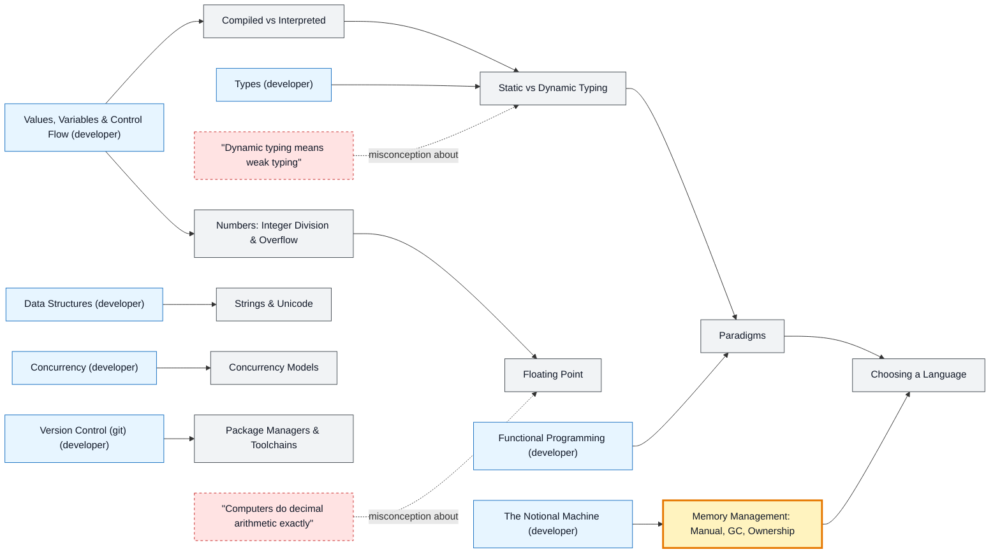

# Programming Language Concepts map

_Generated by `python scripts/dulta.py render` from `maps/plcore.json`. Edit the JSON, not this file._

The ideas every language makes choices about: compilation, typing, memory, numbers, strings and concurrency. Memory management is the threshold: once you see who frees memory and when, the differences between C, Java, Python and Rust stop being folklore.

Solid arrows: prerequisite (A grounds B). Dotted arrows: a misconception that blocks the concept it points at. Thick amber nodes are threshold concepts (Meyer & Land): transformative, troublesome, irreversible.

| Node | Kind | Outcome | Retrieval check |
|---|---|---|---|
| `compiled` Compiled vs Interpreted | concept | Explain how a given language turns source into running code. | What is the main difference between an ahead-of-time compiled language and an interpreted one? |
| `typing` Static vs Dynamic Typing | concept | Classify languages by static/dynamic and strong/weak typing. | When are type errors caught in a statically typed language? |
| `misc-strong` "Dynamic typing means weak typing" | misconception | Separate static/dynamic from strong/weak typing. | Python is dynamically typed. Is '1' + 1 allowed in Python? |
| `memory` Memory Management: Manual, GC, Ownership | threshold | Compare the costs and failure modes of each memory strategy. | Name the three main approaches to freeing memory, with a language for each. |
| `paradigms` Paradigms | concept | Solve one problem in two paradigms and compare. | Which paradigm treats computation as evaluating functions without changing state? |
| `intdiv` Numbers: Integer Division & Overflow | concept | Predict integer arithmetic results across languages. | In C and Java, what is 7 / 2 when both operands are integers? |
| `floats` Floating Point | concept | Explain and avoid floating-point comparison bugs. | Why is 0.1 + 0.2 == 0.3 false in most languages? |
| `misc-float` "Computers do decimal arithmetic exactly" | misconception | Choose a correct representation for money. | Should you store money as a binary floating-point number? |
| `strings` Strings & Unicode | concept | Handle text correctly in at least two languages. | Why can the 'length' of '👍🏽' differ between languages? |
| `concurrencymodels` Concurrency Models | concept | Choose a concurrency model for a workload. | How does Go's approach to concurrency differ from shared-memory threads with locks? |
| `tooling` Package Managers & Toolchains | concept | Set up a reproducible project in a new language. | What does a lockfile (package-lock.json, Cargo.lock, poetry.lock) guarantee? |
| `choosing` Choosing a Language | concept | Justify a language choice for a project with an ADR. | Why is C still the default for microcontroller firmware? |

Sources: Abelson & Sussman: Structure and Interpretation of Computer Programs; Pierce: Types and Programming Languages; Scott: Programming Language Pragmatics; Goldberg: What Every Computer Scientist Should Know About Floating-Point Arithmetic (1991); Klabnik & Nichols: The Rust Programming Language
