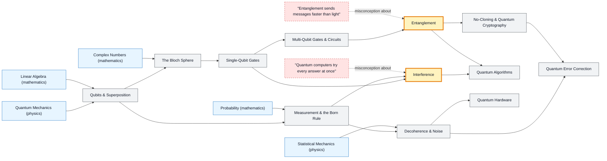

# Quantum Computing map

_Generated by `python scripts/dulta.py render` from `maps/quantum.json`. Edit the JSON, not this file._

Computing with amplitudes. Entanglement is the threshold: multi-qubit states that cannot be described one qubit at a time. Speed-ups come from interference steering amplitude toward right answers, not from trying every answer at once.

Solid arrows: prerequisite (A grounds B). Dotted arrows: a misconception that blocks the concept it points at. Thick amber nodes are threshold concepts (Meyer & Land): transformative, troublesome, irreversible.

| Node | Kind | Outcome | Retrieval check |
|---|---|---|---|
| `qubit` Qubits & Superposition | concept | Write a normalised qubit state and compute measurement probabilities. | A qubit is √0.8|0⟩ + √0.2|1⟩. What is the probability of measuring 0? |
| `measurement` Measurement & the Born Rule | concept | Estimate a probability from shot counts and its uncertainty. | After measuring a qubit and getting 1, what do you get if you measure it again immediately? |
| `bloch` The Bloch Sphere | concept | Place |0⟩, |1⟩, |+⟩ and |−⟩ on the Bloch sphere. | Where on the Bloch sphere is the state |+⟩ = (|0⟩ + |1⟩)/√2? |
| `gates` Single-Qubit Gates | concept | Predict the output of a short gate sequence on |0⟩. | What do you get applying H twice to |0⟩? |
| `interference` Interference | threshold | Explain H·H|0⟩ = |0⟩ as two paths to |1⟩ cancelling. | Why can two quantum paths to the same outcome make that outcome less likely, unlike classical probabilities? |
| `misc-parallel` "Quantum computers try every answer at once" | misconception | Explain why superposition alone gives no speed-up. | You put n qubits in superposition over all inputs and measure. What do you get? |
| `entanglement` Entanglement | threshold | Show the Bell state is not a product state and predict joint measurements. | In the Bell state (|00⟩ + |11⟩)/√2, the first qubit is measured as 1. What will the second qubit give? |
| `misc-ftl` "Entanglement sends messages faster than light" | misconception | Explain the no-signalling theorem with a Bell pair. | Can Alice send Bob a message instantly by measuring her half of an entangled pair? |
| `cnot` Multi-Qubit Gates & Circuits | concept | Build a Bell-state circuit and trace its state. | Which two gates, applied to |00⟩, create a Bell state? |
| `noclone` No-Cloning & Quantum Cryptography | concept | Explain how BB84 detects an eavesdropper. | Why does an eavesdropper on a BB84 key exchange get caught? |
| `algorithms` Quantum Algorithms | concept | State the speed-up of Grover's algorithm and why it is quadratic. | Grover's algorithm searches N unsorted items in about how many steps? |
| `decoherence` Decoherence & Noise | concept | Estimate how many gates fit inside a coherence time. | A qubit's coherence time is 100 µs and each gate takes 50 ns. Roughly how many gates fit? |
| `qec` Quantum Error Correction | concept | Explain how syndrome measurement finds an error without collapsing the data. | Why can't quantum error correction just copy a qubit three times like a classical repetition code? |
| `hardware` Quantum Hardware | concept | Compare two hardware platforms on gate speed, fidelity and connectivity. | Why are superconducting qubits kept near absolute zero? |

Sources: Nielsen & Chuang: Quantum Computation and Quantum Information; Aaronson: Quantum Computing Since Democritus; Preskill: Quantum Computing in the NISQ era and beyond (2018); Mermin: Quantum Computer Science; Grover: A fast quantum mechanical algorithm for database search (1996)
