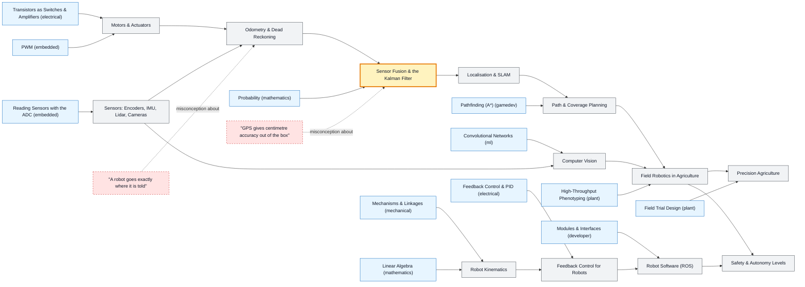

# Robotics & Agricultural Robotics map

_Generated by `python scripts/dulta.py render` from `maps/robotics.json`. Edit the JSON, not this file._

Machines that sense, decide and act in the real world, with field agriculture as the hardest proving ground: uneven ground, changing light, living plants. The threshold is uncertainty: every sensor lies a little, so robots estimate their state rather than know it.

Solid arrows: prerequisite (A grounds B). Dotted arrows: a misconception that blocks the concept it points at. Thick amber nodes are threshold concepts (Meyer & Land): transformative, troublesome, irreversible.

| Node | Kind | Outcome | Retrieval check |
|---|---|---|---|
| `kinematics` Robot Kinematics | concept | Compute forward kinematics for a two-link arm. | Why is inverse kinematics harder than forward kinematics? |
| `actuators` Motors & Actuators | concept | Choose a motor and gear ratio for a wheel load. | Why might a robot use a stepper motor for a seed-spacing mechanism? |
| `sensors` Sensors: Encoders, IMU, Lidar, Cameras | concept | Match sensors to measurement needs and list each one's failure modes. | Why does integrating a gyroscope's angular rate give a heading that drifts? |
| `misc-gps` "GPS gives centimetre accuracy out of the box" | misconception | Explain what RTK adds to GNSS. | Roughly how accurate is standard consumer GPS, and what upgrades it to centimetres? |
| `odometry` Odometry & Dead Reckoning | concept | Compute odometry for a differential-drive robot and predict its drift. | A field robot's wheels slip in mud. What happens to its odometry estimate? |
| `misc-exact` "A robot goes exactly where it is told" | misconception | Design a feedback correction for commanded motion. | Why does a robot told to drive 10 m straight end up off course? |
| `fusion` Sensor Fusion & the Kalman Filter | threshold | Run one predict–update cycle of a 1D Kalman filter. | In a Kalman filter, when should the estimate trust the new measurement more than the prediction? |
| `control` Feedback Control for Robots | concept | Tune a PID controller to follow a crop row. | A row-following robot weaves from side to side. Which PID gain is most likely too high? |
| `vision` Computer Vision | concept | Train and evaluate a crop–weed segmentation model. | Why do vision models for farms often fail when moved to a new field or season? |
| `localization` Localisation & SLAM | concept | Explain why loop closure matters in SLAM. | What does loop closure do in SLAM? |
| `planning` Path & Coverage Planning | concept | Plan a coverage path for a field and a detour around an obstacle. | Why do field robots plan boustrophedon (back-and-forth) paths? |
| `ros` Robot Software (ROS) | concept | Wire sensor, planner and controller nodes over ROS topics. | Why test robot software in simulation before the field? |
| `agrifield` Field Robotics in Agriculture | concept | Specify a weeding robot: sensing, actuation, speed and payback. | Why is robotic fruit picking much harder than robotic weeding? |
| `precisionag` Precision Agriculture | concept | Build a variable-rate fertiliser map from yield and soil data. | What is the benefit of variable-rate fertiliser application over a uniform rate? |
| `safety` Safety & Autonomy Levels | concept | Write a risk assessment for an autonomous tractor. | Name two safety layers an autonomous tractor should have. |

Sources: Siegwart, Nourbakhsh, Scaramuzza: Introduction to Autonomous Mobile Robots; Thrun, Burgard, Fox: Probabilistic Robotics; Lynch & Park: Modern Robotics; Corke: Robotics, Vision and Control; Bechar & Vigneault: Agricultural robots for field operations (2016)
