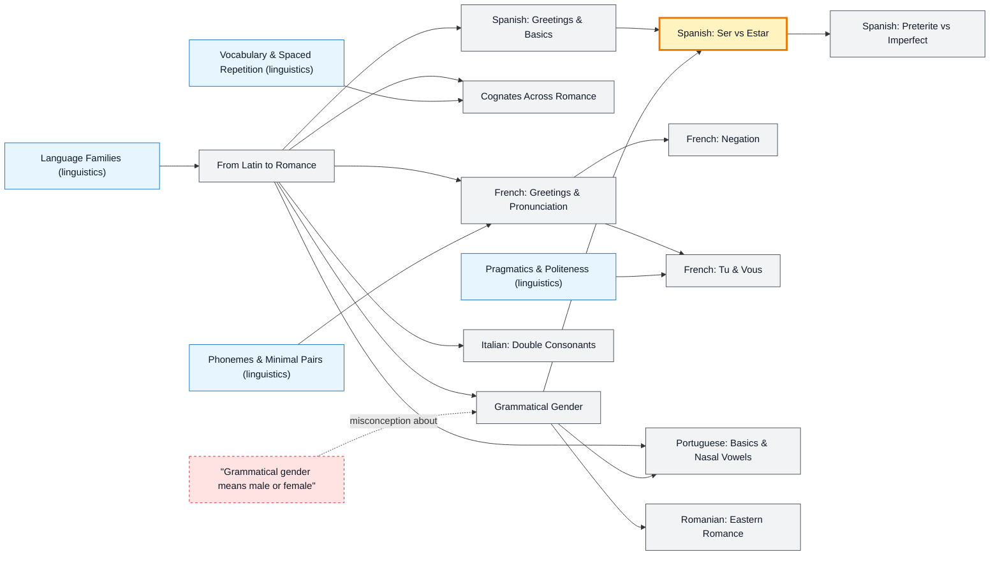

# Romance Languages map

_Generated by `python scripts/dulta.py render` from `maps/romance.json`. Edit the JSON, not this file._

Spanish, French, Portuguese, Italian and Romanian: one Latin inheritance, five sound systems. Learn the shared core once (gender, conjugation, cognates) and each further language costs far less than the first.

Solid arrows: prerequisite (A grounds B). Dotted arrows: a misconception that blocks the concept it points at. Thick amber nodes are threshold concepts (Meyer & Land): transformative, troublesome, irreversible.

| Node | Kind | Outcome | Retrieval check |
|---|---|---|---|
| `latin` From Latin to Romance | concept | Trace a word from Latin into three Romance languages. | Spanish, French, Italian, Portuguese and Romanian descend from which language? |
| `gender` Grammatical Gender | concept | Choose articles and adjective endings that agree. | In Spanish, which article goes with 'mesa' (table): el or la? |
| `misc-gender` "Grammatical gender means male or female" | misconception | Separate grammatical gender from sex. | Is Spanish 'la persona' used only for women? |
| `cognates` Cognates Across Romance | concept | Guess a word's meaning across Romance languages from its root. | Spanish 'noche', French 'nuit', Italian 'notte' and Portuguese 'noite' all mean what? |
| `es-basics` Spanish: Greetings & Basics | concept | Greet, thank and introduce yourself in Spanish. | How do you say 'thank you very much' in Spanish? |
| `es-serestar` Spanish: Ser vs Estar | threshold | Choose ser or estar correctly in context. | Which verb completes 'Ella ___ cansada' (she is tired): es or está? |
| `es-past` Spanish: Preterite vs Imperfect | concept | Tell a short story mixing preterite and imperfect. | Which past tense describes an ongoing background state, as in 'when I was a child'? |
| `fr-basics` French: Greetings & Pronunciation | concept | Read French aloud with silent letters and liaison. | Is the final 's' in French 'Paris' pronounced? |
| `fr-neg` French: Negation | concept | Negate French sentences, including with ne … jamais and ne … plus. | Make 'Je parle' (I speak) negative. |
| `fr-tuvous` French: Tu & Vous | concept | Choose tu or vous by relationship and setting. | Which pronoun do you use with a stranger or your boss in French: tu or vous? |
| `pt` Portuguese: Basics & Nasal Vowels | concept | Greet and thank in Portuguese with correct agreement. | How do you say 'thank you' in Portuguese, as a man and as a woman? |
| `it` Italian: Double Consonants | concept | Pronounce and spell double consonants correctly. | In Italian 'pala' means shovel. What does 'palla', with a doubled consonant, mean? |
| `ro` Romanian: Eastern Romance | concept | Form definite nouns with Romanian's suffixed article. | Romanian attaches 'the' to the end of the noun. 'Om' means man; how do you say 'the man'? |

Sources: Penny: A History of the Spanish Language; Posner: The Romance Languages; Butt & Benjamin: A New Reference Grammar of Modern Spanish; Hawkins & Towell: French Grammar and Usage; Real Academia Española: Diccionario de la lengua española
