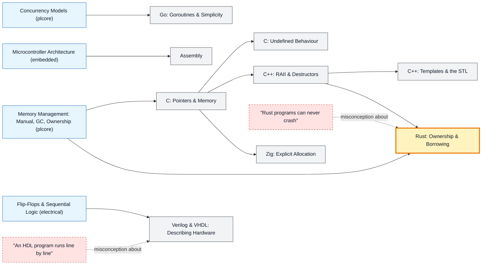

# Systems & Hardware Languages map

_Generated by `python scripts/dulta.py render` from `maps/systemslang.json`. Edit the JSON, not this file._

C, C++, Rust, Go, Zig, assembly and hardware description languages: close to the machine, where you choose the memory layout and pay for every abstraction. Rust's ownership model is the threshold of this family.

Solid arrows: prerequisite (A grounds B). Dotted arrows: a misconception that blocks the concept it points at. Thick amber nodes are threshold concepts (Meyer & Land): transformative, troublesome, irreversible.

| Node | Kind | Outcome | Retrieval check |
|---|---|---|---|
| `c-pointers` C: Pointers & Memory | concept | Trace pointer arithmetic and manage heap memory in C. | In C, what does *p mean when p is a pointer? |
| `c-ub` C: Undefined Behaviour | concept | Spot undefined behaviour and enable sanitizers to catch it. | What may a C compiler do with code that reads past the end of an array? |
| `cpp-raii` C++: RAII & Destructors | concept | Write a RAII wrapper and use smart pointers. | In C++ RAII, when is a resource such as a file or lock released? |
| `cpp-stl` C++: Templates & the STL | concept | Choose STL containers and algorithms for a task. | What does std::vector<int> give you that a raw C array doesn't? |
| `rust-ownership` Rust: Ownership & Borrowing | threshold | Fix borrow-checker errors by restructuring ownership. | In Rust, how many mutable references to a value may exist at the same time? |
| `misc-rust` "Rust programs can never crash" | misconception | Handle errors with Result instead of panicking. | Can a safe Rust program still panic? |
| `go` Go: Goroutines & Simplicity | concept | Write a concurrent Go program with goroutines and channels. | How do you run a function concurrently in Go? |
| `zig` Zig: Explicit Allocation | concept | Pass allocators explicitly in Zig. | How does Zig make memory allocation explicit? |
| `asm` Assembly | concept | Read the assembly a compiler produces for a small function. | What does an assembler translate, and into what? |
| `hdl` Verilog & VHDL: Describing Hardware | concept | Describe a counter in Verilog and simulate it. | How does a hardware description language differ from a programming language like C? |
| `misc-hdl` "An HDL program runs line by line" | misconception | Reason about simultaneous updates on a clock edge. | In Verilog, two always blocks both trigger on the same clock edge. Which runs first? |

Sources: Kernighan & Ritchie: The C Programming Language; Stroustrup: A Tour of C++; Klabnik & Nichols: The Rust Programming Language; Donovan & Kernighan: The Go Programming Language; Harris & Harris: Digital Design and Computer Architecture
