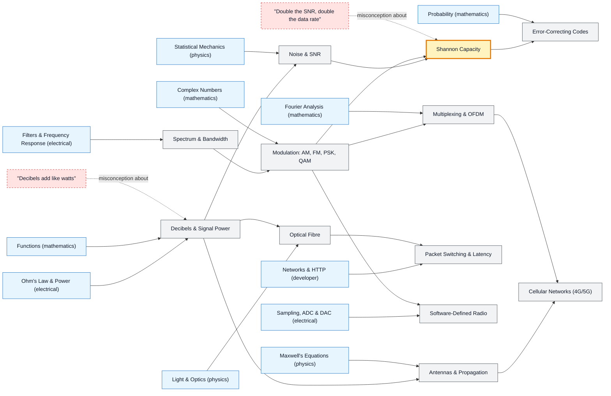

# Telecommunications map

_Generated by `python scripts/dulta.py render` from `maps/telecom.json`. Edit the JSON, not this file._

Moving bits through noisy channels. Shannon capacity is the threshold: bandwidth and signal-to-noise ratio set a hard ceiling on data rate, and every modulation and code is a way of approaching it.

Solid arrows: prerequisite (A grounds B). Dotted arrows: a misconception that blocks the concept it points at. Thick amber nodes are threshold concepts (Meyer & Land): transformative, troublesome, irreversible.

| Node | Kind | Outcome | Retrieval check |
|---|---|---|---|
| `db` Decibels & Signal Power | concept | Convert between power ratios, dB and dBm. | A signal goes from 1 mW to 100 mW. How many dB is that gain? |
| `misc-db` "Decibels add like watts" | misconception | Add two powers given in dBm correctly. | Two equal, uncorrelated 10 dBm signals are combined. Total power? |
| `spectrum` Spectrum & Bandwidth | concept | Read a spectrum plot and measure occupied bandwidth. | Why is radio spectrum licensed and auctioned? |
| `noise` Noise & SNR | concept | Compute thermal noise power for a given bandwidth. | If you double the receiver bandwidth, what happens to thermal noise power? |
| `modulation` Modulation: AM, FM, PSK, QAM | concept | Compute bits per symbol for an M-QAM scheme. | How many bits does each symbol carry in 64-QAM? |
| `shannon` Shannon Capacity | threshold | Compute channel capacity and say which lever (bandwidth or SNR) helps more. | A 1 MHz channel has an SNR of 15 (linear). What is its Shannon capacity? |
| `misc-snr` "Double the SNR, double the data rate" | misconception | Compare the effect of doubling SNR with doubling bandwidth. | At high SNR, doubling the SNR increases capacity by roughly how much? |
| `coding` Error-Correcting Codes | concept | Encode and correct a single-bit error with a Hamming(7,4) code. | A Hamming(7,4) code sends 7 bits for every 4 data bits. What can it correct? |
| `multiplexing` Multiplexing & OFDM | concept | Explain why OFDM handles multipath well. | Why does OFDM cope well with multipath echoes? |
| `propagation` Antennas & Propagation | concept | Compute a link budget and its fade margin. | In free space, how does received power change if distance doubles? |
| `fibre` Optical Fibre | concept | Explain total internal reflection and modal dispersion. | What keeps light inside an optical fibre? |
| `packets` Packet Switching & Latency | concept | Compute end-to-end delay from its four components. | Light in fibre travels about 200,000 km/s. What is the one-way propagation delay over 2,000 km? |
| `cellular` Cellular Networks (4G/5G) | concept | Explain why 5G millimetre-wave cells are small. | Why do 5G millimetre-wave cells cover much less area than low-band cells? |
| `sdr` Software-Defined Radio | concept | Demodulate an FM broadcast with an SDR toolchain. | What hardware does an SDR still need before software takes over? |

Sources: Proakis & Salehi: Digital Communications; Haykin: Communication Systems; Shannon: A Mathematical Theory of Communication (1948); Goldsmith: Wireless Communications; Kurose & Ross: Computer Networking
