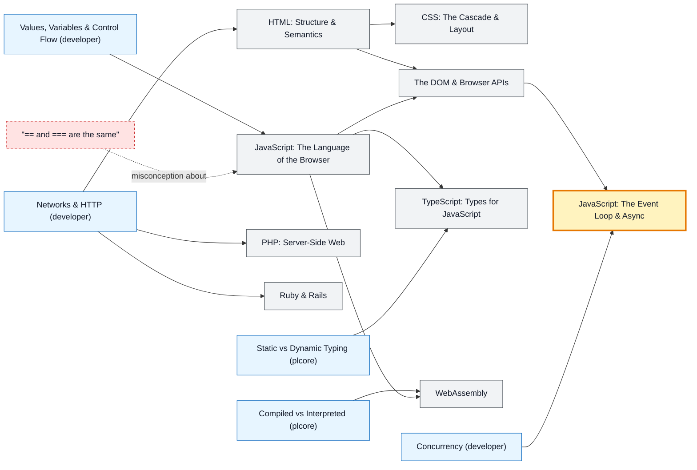

# Web Languages map

_Generated by `python scripts/dulta.py render` from `maps/weblang.json`. Edit the JSON, not this file._

HTML, CSS, JavaScript, TypeScript, PHP, Ruby and WebAssembly: the languages of the browser and the server behind it. The event loop is the threshold: until it clicks, asynchronous JavaScript looks like it runs in random order.

Solid arrows: prerequisite (A grounds B). Dotted arrows: a misconception that blocks the concept it points at. Thick amber nodes are threshold concepts (Meyer & Land): transformative, troublesome, irreversible.

| Node | Kind | Outcome | Retrieval check |
|---|---|---|---|
| `html` HTML: Structure & Semantics | concept | Mark up a page with semantic, accessible HTML. | Why use <button> instead of a clickable 
? |
| `css` CSS: The Cascade & Layout | concept | Lay out a responsive page with grid and flexbox. | Two CSS rules with equal specificity set the same property. Which one wins? |
| `dom` The DOM & Browser APIs | concept | Update the page from JavaScript through the DOM. | What is the DOM? |
| `js` JavaScript: The Language of the Browser | concept | Write modern JavaScript with modules and const/let. | What does typeof null return in JavaScript? |
| `misc-eq` "== and === are the same" | misconception | Use strict equality and predict coercion. | In JavaScript, what are '0' == 0 and '0' === 0? |
| `async` JavaScript: The Event Loop & Async | threshold | Predict the output order of mixed sync, timer and promise code. | setTimeout(f, 0) is called, then console.log('a'). Which runs first, f or the log? |
| `ts` TypeScript: Types for JavaScript | concept | Type a JavaScript module with TypeScript. | Do TypeScript's types exist at run time in the browser? |
| `php` PHP: Server-Side Web | concept | Render a page from a PHP template with escaped output. | Where does PHP code run: in the browser or on the server? |
| `ruby` Ruby & Rails | concept | Scaffold a CRUD app in Rails. | What does 'convention over configuration' mean in Rails? |
| `wasm` WebAssembly | concept | Compile a function to WebAssembly and call it from JavaScript. | Why compile C++ or Rust to WebAssembly? |

Sources: MDN Web Docs (Mozilla); Haverbeke: Eloquent JavaScript; Simpson: You Don't Know JS Yet; WHATWG HTML Living Standard; W3C Web Content Accessibility Guidelines 2.2
